# Company OS Universal Integration Control Plane and Execution Architecture

## Executive summary

The correct architecture for the Company OS is **not one large integration product** and not a direct collection of point-to-point connectors.

It should be a **Company OS-owned Integration Control Plane** above several specialized execution engines:

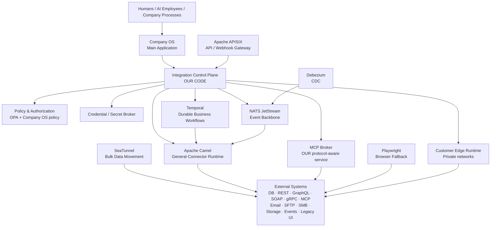

My recommendation after reviewing the current 2026 projects and releases is:

| Responsibility | Recommended foundation | Decision |
|---|---|---|
| Integration product model | **Our code** | Must own |
| Connector/action/trigger contract | **Our code** | Must own |
| Tenant/company/portal policy | **Our code + OPA** | Must own |
| API ingress and webhook gateway | **Apache APISIX** | Reuse |
| General integration/protocol runtime | **Apache Camel** | Reuse |
| Durable multi-step workflows | **Temporal** | Reuse |
| Event backbone | **NATS + JetStream** | Reuse |
| Agent-facing external integrations | **Native MCP broker** | Build on MCP SDK/spec |
| Database change capture | **Debezium** | Reuse |
| Bulk/large-volume data synchronization | **SeaTunnel** | Add when needed |
| Browser-only legacy systems | **Playwright** | Last-resort worker |
| Visual integration designer | **Kaoto code/concepts** | Reuse selectively |
| Ready-made SaaS connector logic | **Activepieces Pieces** | Harvest/adapt selectively |
| Policy engine | **Open Policy Agent** | Reuse |
| SBOM generation | **Syft** | Reuse |
| Vulnerability scanning | **Grype or equivalent** | Reuse |
| Artifact signing | **Cosign** | Reuse |

This design deliberately separates **what the Company OS believes an integration means** from **how a specific system happens to implement it**.

An AI employee should ask for:

```text
crm.contact.search
crm.contact.update
invoice.read
invoice.create
document.search
email.send
calendar.event.create
project.create
```

It should not normally need to know that Company A uses REST, Company B uses PostgreSQL, Company C exposes MCP, and Company D can only be automated through a browser.

That abstraction is the critical product asset.

### Main conclusions

**Apache Camel should be the broad connector/protocol engine.** Camel's current 4.18 LTS catalog includes JDBC/SQL, REST/OpenAPI, GraphQL, gRPC, Kafka, web services, SFTP and many other integration components; its REST OpenAPI component can consume OpenAPI 3.x descriptions. citeturn18search0turn18search3turn18search6turn18search9 The current supported LTS is 4.18.x; 4.18.3 was released in July 2026, while 4.21.0 is the newer feature release. The project also publishes CycloneDX SBOMs for modern releases. citeturn0search0turn0search7

**APISIX should be the north-south API/webhook gateway, not the integration engine.** Version 3.17.0 was released June 15, 2026 and added stricter authentication/TLS behavior, new access controls, GraphQL traffic controls, data-protection features and other gateway improvements. It is Apache-2.0 licensed. citeturn19search0turn19search1

**Temporal should own long-lived orchestration.** Temporal Server 1.31.2 is current as of August 10, 2026, is MIT licensed, and exists specifically to execute durable workflows that survive failures and retry failed activities. citeturn16search1

**NATS JetStream should be the default internal event backbone**, but we should design the business layer around **at-least-once delivery plus idempotency**, not advertise magical exactly-once business effects. JetStream provides persistence, replay, replicated streams and at-least-once consumption, and it provides message deduplication/double-ack mechanisms for stronger delivery semantics. Application-level idempotency is still necessary. citeturn7search3turn15search9

**MCP should be a first-class integration type but should not replace ordinary APIs.** The July 28, 2026 MCP specification is the current release and moves the protocol toward a stateless HTTP-friendly architecture. MCP tools are explicitly designed to let models invoke external systems, and the specification requires serious consent and authorization controls. citeturn20search3turn20search5turn20search1turn20search4

**Debezium should handle database CDC rather than us inventing CDC.** Debezium 3.6.1.Final was released August 4, 2026 and includes integrity/security fixes. The stable release supports major database families and can also be embedded through the Debezium Engine API. citeturn14search0turn14search1turn14search7

**SeaTunnel should remain an optional specialist engine.** Version 2.3.13 is current in the retrieved release stream and is designed for distributed, high-volume data integration. Its JDBC sink supports both batch and streaming execution and can use XA for stronger write guarantees where the database supports it. citeturn15search2turn15search12turn2search0

**Playwright belongs at the bottom of the preference ladder.** Playwright 1.62.1 is current as of this research, Apache-2.0 licensed, and supports Chromium, Firefox and WebKit. It is excellent automation infrastructure, but browser automation is inherently more fragile than a stable programmatic interface. citeturn16search0

The most important deployment capability that should be added to the previous design is a **Customer Edge Integration Runtime**. Many of the businesses we want to serve will have databases, SMB shares, SFTP servers, old ERP systems and internal APIs that cannot safely be exposed to the Internet. The Company OS should therefore support a small customer-hosted runtime that makes **outbound authenticated connections to our control plane** and executes approved integrations inside the customer's network.

That dramatically expands what “integrate with anything” means without requiring customers to open inbound database ports to us.

## Integration coverage and priorities

The platform should not treat all integration mechanisms as equal. There should be a preference order based on stability, security and maintainability.

### Recommended integration preference

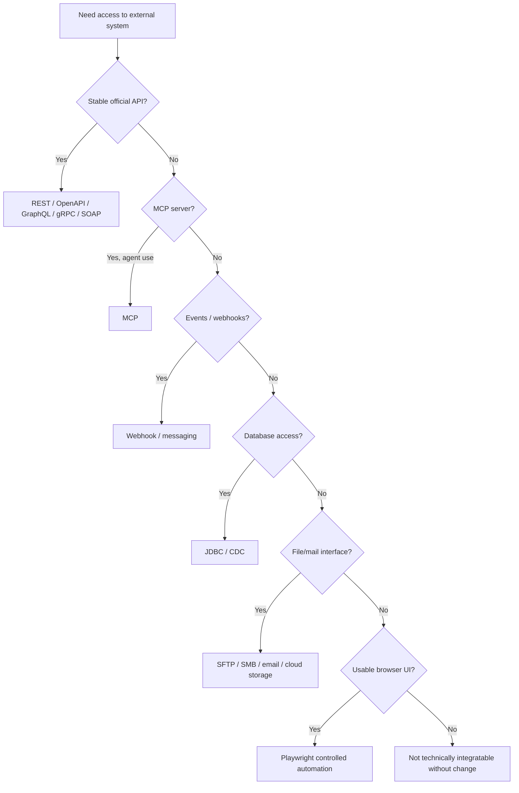

This ordering is not absolute. For example, CDC may be preferable to a poorly designed polling API, and MCP may be the official interface supplied by a modern AI-oriented product.

### Priority tiers

| Priority | Integration family | Typical purpose | Primary runtime |
|---|---|---|---|
| **P0** | REST / OpenAPI | Most SaaS and modern business systems | Camel |
| **P0** | Webhooks | Immediate incoming events | APISIX + Control Plane |
| **P0** | JDBC / SQL | Legacy/on-prem databases, analytics, controlled writes | Camel |
| **P0** | MCP | Agent-facing tools/resources | Native MCP Broker |
| **P0** | Email | Mailboxes as business interfaces | Camel |
| **P0** | Files / SFTP / SMB | Legacy exchange, imports/exports | Camel |
| **P0** | Cloud object/file storage | Documents, exports, archives | Camel/native connector |
| **P1** | GraphQL | Schema-driven SaaS APIs | Camel/native HTTP |
| **P1** | gRPC | Internal services and modern infrastructure | Camel/APISIX |
| **P1** | SOAP / XML web services | ERP, financial, government and legacy enterprise | Camel |
| **P1** | Messaging | NATS, Kafka, AMQP/JMS, MQTT | Camel + native bus |
| **P1** | CDC | Near-real-time DB change streams | Debezium |
| **P2** | Bulk/ETL/ELT | Millions of rows / historical migrations | SeaTunnel |
| **P2** | Streaming data pipelines | Continuous high-volume movement | SeaTunnel / Kafka / NATS depending workload |
| **P3** | Browser automation | Systems with no usable interface | Playwright |

Camel 4.18 LTS directly covers a large fraction of this table. Its component catalog includes GraphQL, gRPC, JDBC/SQL, Spring Web Services, REST/OpenAPI, Kafka and numerous SaaS/cloud integrations. Its broader catalog also lists Google Drive, Google Mail, Google Sheets, Google Storage and similar services. citeturn18search0turn18search17turn18search19

Its GraphQL implementation is currently a client supporting queries and mutations but not GraphQL subscriptions, so GraphQL subscriptions should be handled separately if a vendor requires them. citeturn18search3

Camel's REST OpenAPI support handles OpenAPI 3.x, not old Swagger 2.0, so the Connector SDK should contain a normalization/conversion step for legacy Swagger descriptions. citeturn18search6

### What “integrate with anything” honestly means

There is no software platform that can literally integrate with every external system.

An external system needs at least one usable surface:

```text
API
OR
MCP
OR
event/webhook
OR
database protocol
OR
message protocol
OR
mail
OR
file exchange
OR
browser/interface that can be automated
```

If a system is physically unreachable, exposes no interface, and cannot be automated through its UI, integration is impossible until something changes at that system.

Our goal should therefore be:

> **Support every major class of interface, with a controlled fallback ladder.**

### Direct database integration

For relational systems, JDBC should be our generic protocol.

Camel's JDBC and SQL components let routes execute database operations through a supplied datasource. citeturn18search9turn18search0

A database connection should contain:

```text
DatabaseConnection
├── engine / driver
├── host
├── port
├── database
├── TLS policy
├── credential_ref
├── allowed schemas
├── allowed tables
├── allowed operations
├── query timeout
├── concurrency limit
├── connection pool policy
└── execution location
```

Execution location is important:

```text
Cloud reachable database
    → Company OS connector worker

Private database
    → Customer Edge Runtime

High-security database
    → Dedicated tenant worker
```

For AI-facing access, arbitrary SQL should **not** be the default.

Instead:

```text
AI Employee
    ↓
finance.invoice.search
    ↓
Capability Service
    ↓
Approved parameterized query
    ↓
Database
```

This avoids giving a model unrestricted SQL authority.

### REST and OpenAPI

REST/OpenAPI should be the easiest connector type to create.

An import wizard should accept:

```text
OpenAPI URL
OpenAPI file
API base URL
Authentication configuration
```

Then generate draft:

- Operations.
- Input/output schemas.
- Capabilities.
- Authentication requirements.
- Retry rules.
- Rate-limit fields.
- Test requests.

Camel can construct REST producers from OpenAPI 3.x definitions. citeturn18search6 APISIX 3.17 also provides OpenAPI request validation through its OAS validator functionality, which is useful at the ingress boundary. citeturn8search0turn19search0

Generated operations must still be reviewed. An OpenAPI document generally does not tell us enough about:

- Business side effects.
- Idempotency.
- Approval risk.
- Vendor quotas.
- Semantic meaning.
- Data sensitivity.

Those belong in our connector manifest.

### Webhooks

Inbound webhooks should terminate at APISIX and our Webhook Ingress Service:

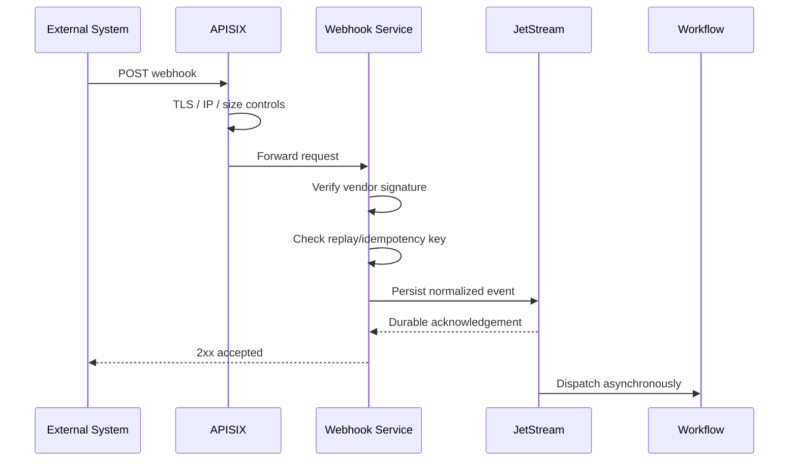

Where vendors support signed webhooks, the connector should supply signature verification.

For example, Frappe's current webhook mechanism can add an `X-Frappe-Webhook-Signature` containing an HMAC-SHA256 signature when a webhook secret is configured. citeturn21search11

### Email and files

Mail/file interfaces deserve first-class status rather than being treated as old-fashioned exceptions.

A business integration might be:

```text
New message arrives in invoices@company.com
        ↓
Validate sender
        ↓
Extract PDF
        ↓
Run document extraction
        ↓
Match supplier
        ↓
Create review task
        ↓
Post approved invoice
```

Similarly:

```text
Supplier writes:
/outbound/orders_2026-08-10.csv
        ↓
SFTP watcher
        ↓
Validate checksum and schema
        ↓
Import
        ↓
Archive
        ↓
Emit OrderImportCompleted
```

Camel supplies SFTP support and related file-transfer components. citeturn18search5turn18search14

### Public APIs for our own platform

A universal integration platform must itself be easy to integrate **into**.

Company OS should expose:

- REST/OpenAPI.
- Webhooks.
- MCP server.
- Event subscriptions.
- Bulk export/import.
- Eventually gRPC for internal/high-volume clients.

This creates two directions:

```text
External software
      ↕
Integration Fabric
      ↕
Company OS
```

not merely:

```text
Company OS
      ↓
External software
```

## Recommended open-source stack and deployment architecture

The following versions/statuses are current to the research date, **August 10, 2026**.

| Project | Current/recommended status | License | Role in our architecture | Source |
|---|---|---|---|---|
| Apache Camel | **4.18.3 LTS** recommended baseline; 4.21.0 current newer line | Apache-2.0 | General connector/protocol runtime | [Downloads](https://camel.apache.org/download/) citeturn0search0turn0search7 |
| Apache APISIX | **3.17.0**, June 15, 2026 | Apache-2.0 | API/webhook ingress, routing, auth, throttling | [3.17 release](https://apisix.apache.org/blog/2026/06/15/release-apache-apisix-3.17.0/) citeturn19search0turn19search1 |
| Debezium | **3.6.1.Final**, August 4, 2026 | Apache-2.0 | CDC | [3.6.1 release](https://debezium.io/blog/2026/08/04/debezium-3-6-1-final-released/) citeturn14search0turn14search13 |
| Temporal Server | **1.31.2**, July 8, 2026 | MIT | Durable orchestration | [Repository](https://github.com/temporalio/temporal) citeturn16search1 |
| NATS Server | **2.14.3**, June 29, 2026 | Apache-2.0 | Internal event backbone / JetStream | [Releases](https://github.com/nats-io/nats-server/releases) citeturn15search9turn6search1 |
| Apache SeaTunnel | **2.3.13**, March 2026 | Apache-2.0 | Bulk/stream data movement | [Releases](https://github.com/apache/seatunnel/releases) citeturn15search2turn15search12 |
| Playwright | **1.62.1** | Apache-2.0 | Browser automation fallback | [Repository](https://github.com/microsoft/playwright) citeturn16search0 |
| Kaoto | **2.11**, June 17, 2026 | Apache-2.0 | Visual Camel design / mapping inspiration or reuse | [Repository](https://github.com/KaotoIO/kaoto) citeturn2search3turn10view2 |
| Activepieces | **0.87.0**, August 6, 2026 | MIT Community + commercial EE sections | Reusable TypeScript connector logic | [Releases](https://github.com/activepieces/activepieces/releases) citeturn17view0turn16search3 |
| MCP specification | **2026-07-28** | MIT specification repository | Agent integration standard | [Specification](https://modelcontextprotocol.io/specification/2026-07-28) citeturn20search3turn20search4 |
| Open Policy Agent | Active project | Apache-2.0 | Fine-grained policy evaluation | [Repository](https://github.com/open-policy-agent/opa) citeturn14search2 |

### Apache Camel

**Recommended role:** generic execution adapter.

Use Camel for:

- HTTP.
- REST/OpenAPI.
- JDBC/SQL.
- SOAP.
- GraphQL.
- gRPC.
- SFTP/FTP.
- Mail.
- Kafka/JMS.
- Cloud storage.
- SaaS connectors.
- Enterprise protocols.

Camel should **not own**:

- Tenants.
- Company roles.
- Human/AI identities.
- Connections.
- Secrets.
- Business workflow definitions.
- Company-level permissions.

It should receive a narrow execution request:

```json
{
  "runId": "run_123",
  "tenantId": "tenant_a",
  "connectionHandle": "execconn_x",
  "connector": "erpnext",
  "connectorVersion": "2.1.0",
  "capability": "finance.invoice.read",
  "input": {
    "invoiceId": "INV-1008"
  }
}
```

and return a normalized result.

**Strengths:** extremely broad protocol coverage; mature routing patterns; support for circuit breakers and saga patterns; several deployment forms; OpenAPI tooling. Camel provides a Circuit Breaker EIP and Saga EIP in its current documentation. citeturn8search2turn8search5

**Weaknesses:** Java ecosystem; significant surface area; easy to create overly complex routes; it is an integration framework rather than our desired product/control plane.

**Version policy:** use the newest patched LTS rather than blindly using the initial LTS release. For example, Camel's advisory for CVE-2026-46590 affected earlier 4.18 releases and is fixed in 4.18.3, illustrating why patch-level upgrades matter. citeturn8search11

### Apache APISIX

**Recommended role:** public protocol boundary.

Use APISIX for:

- Public Company OS API.
- Incoming webhooks.
- External MCP-over-HTTP front door.
- Rate limits.
- Authentication adapters.
- TLS.
- Request-size rules.
- IP rules.
- Canary routing.
- OpenAPI validation.
- Gateway metrics.

APISIX's OIDC plugin can authenticate through OpenID Connect providers, and its OAS validator can validate requests against OpenAPI specifications. citeturn8search3turn8search0

Do not turn APISIX into the entire authorization system. Gateway authorization is only the first layer.

### Temporal

**Recommended role:** orchestration when business state must survive time and failure.

Example:

```text
CustomerContractSigned
    ↓
Create CRM customer
    ↓
Create ERP customer
    ↓
Wait for Finance approval
    ↓
Create project
    ↓
Create document folder
    ↓
Assign onboarding AI
    ↓
Wait up to 72 hours for missing documents
    ↓
Escalate if necessary
```

The workflow might exist for days. Temporal is designed for durable workflows and automatic retries after intermittent failures. citeturn16search1

Temporal should not become the generic event bus or connector registry.

Namespaces can provide one technical level of logical isolation in a self-hosted Temporal deployment, but Company OS authorization must still be enforced above them. citeturn6search0

### NATS and JetStream

**Recommended role:** internal event distribution.

Examples:

```text
customer.created
invoice.updated
task.completed
integration.connection.failed
knowledge.updated
ai.action.completed
```

Use plain Core NATS only for ephemeral notifications where loss is acceptable.

Use JetStream whenever an event must be durable/replayable.

JetStream supplies persistent streams and consumers and is built for durable message processing. citeturn7search3

For critical flows, use three replicas at minimum as an architectural baseline, and test filesystem durability behavior explicitly. JetStream documentation discusses the tradeoff between replication and disk synchronization; stronger disk synchronization can be selected at a performance cost. citeturn7search3

### Debezium

**Recommended role:** change capture from databases we do not control.

Example:

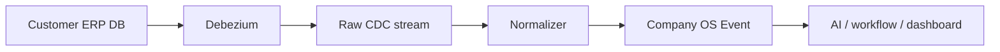

Debezium's stable connector set covers PostgreSQL, MySQL, MariaDB, SQL Server, Oracle, Db2, MongoDB and other supported stores. citeturn1search1turn14search7

### SeaTunnel

**Recommended role:** exceptional volume.

Do not route a 500-million-row migration through ordinary interactive Camel actions.

Use SeaTunnel for:

- Initial migration.
- Data warehouse loads.
- Large table copies.
- High-volume continuous synchronization.
- Large file pipelines.

SeaTunnel 2.3.13 supports distributed data-integration workloads and JDBC batch/stream sinks. citeturn15search2turn2search0

### Playwright

**Recommended role:** explicit fallback.

It should run in a dedicated browser-worker tier, not inside an API server or AI-agent runtime.

Playwright currently supports Chromium, Firefox and WebKit through one automation framework, and the current project is Apache-2.0. citeturn16search0

### Kaoto

Kaoto is a useful source of:

- Camel flow visualization.
- Component property editors.
- Data mapping UI.
- Testing UI.
- Kamelet/component discovery.

The project describes access to hundreds of Camel components/Kamelets and visual data mapping, and is Apache-2.0 licensed. citeturn10view2

I would reuse or learn from Kaoto rather than expose Kaoto itself as the customer integration product.

### Activepieces

Activepieces should be treated as a **connector source ecosystem**, not our architectural kernel.

Its Pieces system is TypeScript-based and the project reports more than 280 pieces; the Community Edition is MIT while enterprise areas are commercially licensed. citeturn16search3 Version 0.87.0 was released August 6, 2026 and includes ongoing connector, OAuth, MCP, sandbox and workflow work. citeturn17view0

The rule should be:

```text
Activepieces piece
    ↓
license/dependency review
    ↓
code/API recertification
    ↓
our compatibility wrapper
    ↓
our Connector Contract
```

Do not make our `Connection`, `Tenant`, `Policy`, `Run` or `Flow` objects depend on Activepieces internals.

### Private-network Edge Runtime

This should be an important proprietary part of the architecture.

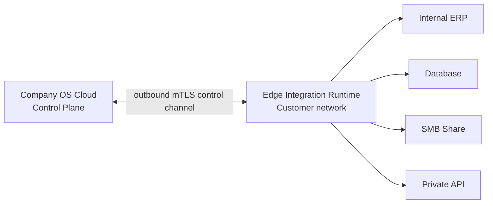

The customer should **not** normally need to expose:

```text
5432 PostgreSQL
3306 MySQL
445 SMB
22 SFTP
internal ERP API
```

to the public Internet.

The Edge Runtime:

- Makes an outbound connection.
- Receives signed job/capability definitions.
- Gets only temporary credential handles.
- Runs selected Camel/native connectors.
- Sends normalized results/events back.
- Has no ability to browse unrelated tenant workloads.
- Can optionally execute Debezium locally.
- Can be customer-managed for high-security installations.

Support three deployment classes:

| Class | Deployment |
|---|---|
| Standard SaaS | Shared control plane + multi-tenant isolated workers |
| Regulated/dedicated | Shared control plane + dedicated execution namespace/node pool |
| Private/on-prem | Edge runtime inside customer's network |

## Control plane, connector contract, security, tenancy, secrets, and MCP governance

The **Integration Control Plane is the part we should build ourselves**.

None of Camel, Temporal, APISIX, Activepieces, Debezium or SeaTunnel knows enough about our:

- Company.
- Portal.
- Departments.
- Human employees.
- AI employees.
- Delegation rules.
- Approval rules.
- Company knowledge.
- AI authority.
- Business context.

### Core control-plane objects

The minimum durable model should contain:

| Object | Purpose |
|---|---|
| `Connector` | Stable logical connector identity |
| `ConnectorVersion` | Immutable implementation version |
| `Connection` | Tenant-owned configuration for one external system |
| `ConnectionCredentialRef` | Reference to encrypted credentials |
| `Capability` | Normalized action/query/event |
| `Trigger` | Source of events/work |
| `WorkflowDefinition` | Business orchestration definition |
| `WorkflowVersion` | Immutable workflow revision |
| `Mapping` | Transformation definition |
| `MappingVersion` | Immutable mapping revision |
| `ExecutionPolicy` | Limits, approvals and risk rules |
| `WebhookEndpoint` | Managed incoming endpoint |
| `Run` | One workflow/integration execution |
| `StepRun` | One execution step |
| `Checkpoint` | Poll/CDC synchronization position |
| `ExternalRecordLink` | Maps IDs across systems |
| `MCPServerConnection` | External MCP endpoint |
| `MCPToolSnapshot` | Approved tool catalog/version |
| `Artifact` | Connector image/package and digest |
| `EdgeRuntime` | Registered private execution node |

A `Connection` should never mean merely “a set of credentials.”

It should be:

```text
Connection
├── tenant
├── owner/scope
├── connector
├── connector version policy
├── environment
├── endpoint
├── auth method
├── credential reference
├── enabled capabilities
├── rate limits
├── execution location
├── network restrictions
├── health
├── data classification
└── policy
```

### Capability abstraction

The most strategically important model is `Capability`.

Vendor operations can map to a semantic capability:

```text
Twenty API
POST /rest/companies
          │
          ▼
crm.company.create


ERPNext API
POST /api/resource/Customer
          │
          ▼
customer.create


Custom PostgreSQL procedure
SELECT create_customer(...)
          │
          ▼
customer.create
```

Not every capability should be universal. Vendor-specific capabilities remain valid:

```text
salesforce.lead.convert
notion.database.query
sap.purchase_order.release
```

The goal is semantic reuse where it provides value, not an impossible universal schema.

### Proposed connector manifest

```yaml
apiVersion: companyos.io/integration/v1
kind: Connector

metadata:
  id: twenty
  name: Twenty CRM
  version: 1.4.0
  publisher: companyos
  license: proprietary-wrapper
  implementationDigest: "sha256:..."
  maturity: certified

runtime:
  type: camel
  image: registry.companyos.io/connectors/twenty@sha256:...
  minimumRuntimeVersion: "1.3"
  timeoutSeconds: 30

network:
  egress:
    - scheme: https
      hosts:
        - "*.twenty.com"
  privateNetworkAllowed: true

connections:
  - id: api-key
    type: bearer
    fields:
      - name: baseUrl
        secret: false
        required: true
      - name: apiKey
        secret: true
        required: true

capabilities:
  - id: crm.company.read
    kind: query
    vendorOperation: company.get
    inputSchema: schemas/company-get.input.json
    outputSchema: schemas/company.json

    sideEffect: none
    retry:
      safe: true
      maxAttempts: 4

    idempotency:
      mode: not-required

    authorization:
      defaultRisk: low

  - id: crm.company.create
    kind: action
    vendorOperation: company.create
    inputSchema: schemas/company-create.input.json
    outputSchema: schemas/company.json

    sideEffect: reversible_write

    idempotency:
      mode: idempotency-key
      scope: connection

    retry:
      safe: true
      maxAttempts: 4
      retryOn:
        - timeout
        - 429
        - 502
        - 503

    authorization:
      defaultRisk: medium
      aiAllowed: policy

rateLimits:
  strategy: token-bucket
  scope: connection
  providerHeaders:
    retryAfter: Retry-After

health:
  capability: crm.company.read
  intervalSeconds: 300
```

### Side-effect classification

Every executable capability must have a declared side effect.

| Class | Meaning | Example |
|---|---|---|
| `none` | Read only | Search contacts |
| `local_write` | Only our state changes | Save mapping |
| `reversible_write` | External change can normally be reverted | Update CRM field |
| `external_communication` | Sends something outside company | Send email |
| `financial` | Moves/commits financial value | Issue refund |
| `destructive` | Deletes or irreversibly changes | Delete contract |
| `security_sensitive` | Access/security change | Create API key |

These classifications become inputs to policy.

Example:

```text
IF actor.type = AI
AND capability.sideEffect = financial
AND amount > 500 EUR
THEN require FinanceManager approval
```

### Idempotency contract

Every write capability must declare one of:

```text
natural-key
provider-idempotency-key
upsert
deduplicated-by-read-before-write
transactional
unsafe
```

`unsafe` means automatic retry is disabled after an ambiguous outcome unless an explicit compensation/reconciliation routine exists.

Example:

```yaml
idempotency:
  mode: provider-idempotency-key
  header: Idempotency-Key
  platformKey:
    format: "{tenantId}:{runId}:{stepId}"
```

### Rate limiting

Rate-limit metadata belongs in the connector definition and can be overridden by a connection.

```yaml
rateLimits:
  - scope: connection
    requests: 100
    period: PT1M

  - capability: crm.search
    concurrency: 5
```

The runtime should support:

- Token bucket.
- Fixed window when vendor semantics require it.
- Max concurrency.
- Per-connection limit.
- Per-tenant limit.
- Global vendor limit.

`429` responses should honor `Retry-After` when supplied.

Twenty's current API documentation, for example, publishes a 100-requests-per-minute limit and up to 60 records per batch, illustrating why these rules should live in connector metadata rather than generic global defaults. citeturn21search2

### Human, AI and service principals

Every execution needs an actor context.

```json
{
  "principal": {
    "id": "agent_finance_001",
    "type": "ai_employee"
  },
  "tenantId": "tenant_492",
  "portalId": "portal_finance",
  "scopeId": "project_882",
  "delegation": {
    "grantedBy": "user_19",
    "expiresAt": "2026-08-10T18:00:00Z"
  },
  "correlationId": "corr_..."
}
```

The worker must **not trust `tenantId` merely because it appears in JSON**.

A signed short-lived execution token should carry the authoritative claims.

### Policy enforcement

Use several enforcement points:

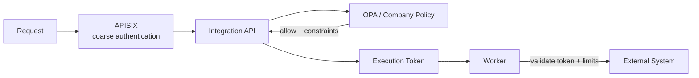

Open Policy Agent is Apache-2.0 and designed as a general-purpose context-aware policy engine, making it suitable as a policy-decision component behind our own policy model. citeturn14search2

Policy inputs can include:

```text
actor
tenant
portal
department
role
AI/human/service
delegation
capability
side-effect classification
resource
customer
project
data classification
amount
time
location
connection
```

Policy outputs should be more expressive than Boolean allow/deny:

```json
{
  "decision": "allow",
  "constraints": {
    "maxRecords": 50,
    "readOnly": true,
    "requireApprovalAbove": 1000,
    "maskFields": ["salary", "nationalId"]
  }
}
```

### Secrets design

The Control Plane database should contain only references:

```text
Connection
credential_ref = cred_x7f9
```

Never:

```text
Connection
password = "..."
refresh_token = "..."
```

The secret subsystem should support a provider-neutral interface:

```typescript
interface SecretProvider {
  putSecret(...): Promise<SecretRef>;
  getForExecution(...): Promise<ExecutionCredential>;
  rotate(...): Promise<void>;
  revoke(...): Promise<void>;
}
```

Recommended rules:

- Envelope encryption with KMS/HSM-backed master keys in production.
- Separate encryption context by tenant.
- Encrypt OAuth refresh tokens.
- Never return long-lived credentials to the browser.
- Never include credentials in AI prompts.
- Never include credentials in event payloads.
- Never include credentials in logs/traces.
- Inject credentials only into the worker that requires them.
- Prefer short-lived credentials/tokens.
- Revoke execution grants immediately when a connection is disabled.

For a database, credentials should ideally belong to a dedicated user with:

```text
read-only
or
specific schema/table/procedure grants
```

rather than a database administrator.

### MCP architecture

MCP deserves its own protocol-aware service:

```text
                       MCP Broker
                 ┌──────────────────┐
Company AI ─────▶│ tool discovery   │─────▶ External MCP
                 │ schema snapshots │
                 │ authorization    │
                 │ policy mapping   │
                 │ consent          │
                 │ risk classes     │
                 │ tracing          │
                 └──────────────────┘

External MCP Client
        │
        ▼
   APISIX
        │
        ▼
Company OS MCP Server
        │
        ▼
Capability Layer
```

This gives us **both directions**:

1. Company OS consumes MCP servers.
2. Company OS itself exposes governed capabilities as MCP tools/resources.

The current MCP specification is version `2026-07-28`, and the specification repository is MIT licensed. citeturn20search3turn20search5

The current specification defines MCP tools as model-controlled operations that may interact with databases, APIs and computations. citeturn20search1

That makes an important distinction:

> MCP is an excellent agent interface. It is not automatically the safest interface for deterministic business transactions.

If an ERP provides both:

```text
POST /invoices
```

and:

```text
MCP tool: create_invoice
```

a deterministic workflow should generally call the direct normalized capability.

An AI employee can use the MCP tool when model-directed interaction is genuinely useful.

### MCP security requirements

Current MCP authorization requires OAuth 2.1 for authorization servers and Protected Resource Metadata for discovery. citeturn20search0turn20search13

Our broker should enforce:

```text
Server registration
    ↓
Protocol discovery
    ↓
Authentication validation
    ↓
List tools/resources
    ↓
Snapshot schemas
    ↓
Risk classification
    ↓
Admin/policy approval
    ↓
Expose approved subset
```

The MCP specification explicitly says tool descriptions/annotations should be considered untrusted unless they come from a trusted server and requires hosts to build consent and access controls around tool invocation. citeturn20search4

Therefore:

**Never trust an MCP server's declaration that an operation is harmless.**

Our catalog determines:

```text
read
write
external communication
financial
destructive
security-sensitive
```

When a tool catalog changes:

```text
Existing approved tool:
notion.search

New tools discovered:
notion.delete_database
notion.share_workspace
```

the new capabilities should remain unavailable until policy/review permits them.

MCP also explicitly forbids unsafe credential passthrough patterns for third-party authorization. Current guidance says third-party credentials must not transit through the MCP client and that the MCP server should manage its separate third-party credentials. citeturn20search9

For remote MCP:

- Prefer the current HTTP transport.
- Put APISIX in front for transport-level security.
- Put our MCP Broker behind APISIX for protocol policy.

For local `stdio` MCP:

- Run in isolated connector/edge workers.
- Never launch arbitrary community MCP packages in the central API process.
- Restrict filesystem.
- Restrict environment variables.
- Restrict egress.
- Pin exact package/artifact versions.

MCP's current specification also uses JSON Schema and recommends JSON Schema 2020-12 when no different dialect is declared, which aligns well with our connector-schema direction. citeturn20search11

## Execution models, reliability, CDC, transformations, and browser fallback

There should not be one execution mode.

### Runtime model matrix

| Model | Example | Engine | Response model |
|---|---|---|---|
| Synchronous | Read customer | Camel/native worker | Immediate |
| Async command | Generate large report | Temporal/worker | `202 + runId` |
| Durable workflow | Customer onboarding | Temporal | Long-running |
| Webhook | Invoice updated | APISIX → JetStream | Fast acceptance |
| Polling | Check new records every 5 min | Temporal/Camel scheduler | Event output |
| Event subscription | Customer changed | JetStream | Async |
| CDC | SQL row changed | Debezium | Continuous |
| Batch | Import 50m rows | SeaTunnel | Job |
| Streaming | Continuous high-volume feed | SeaTunnel/Kafka/NATS | Continuous |
| MCP | AI invokes Notion tool | MCP Broker | RPC/tool invocation |
| Browser | Old portal form | Playwright worker | Usually async |

### Synchronous actions

Use only when:

- Work is fast.
- External provider response is reasonably bounded.
- No human approval is involved.
- One immediate result is useful.

Recommended API shape:

```text
POST /v1/capabilities/crm.company.read:execute
```

Response:

```json
{
  "runId": "run_123",
  "status": "succeeded",
  "result": {
    "id": "company_77",
    "name": "Example AB"
  }
}
```

### Asynchronous actions

If execution can take substantial time:

```http
POST /v1/capabilities/report.generate:execute
```

returns:

```json
{
  "runId": "run_882",
  "status": "queued"
}
```

The client then uses:

```text
GET /v1/runs/run_882
```

or receives an event.

### Reliability baseline

The safest general assumption is:

> **Messages and work may be delivered more than once.**

This is especially important for CDC. Debezium's SQL Server documentation explicitly notes scenarios where source records can be emitted more than once because offsets are persisted periodically. citeturn1search7

Therefore:

```text
at-least-once delivery
+
idempotent consumers
+
deduplicated business writes
=
our baseline
```

Do not market broker-level “exactly once” as equivalent to exactly one business effect.

### Transactional outbox

Every important Company OS database transaction that emits an event should use an outbox.

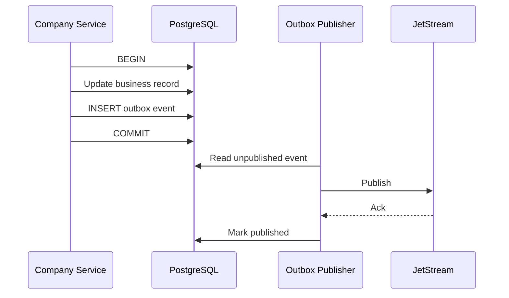

This avoids the classic failure:

```text
DB commit succeeds
↓
process crashes
↓
event never published
```

### Consumer inbox/deduplication

Consumers should maintain:

```text
processed_message
├── tenant_id
├── consumer
├── message_id
├── idempotency_key
├── first_seen_at
└── result_reference
```

with a uniqueness constraint.

Pseudo-code:

```typescript
await db.transaction(async (tx) => {
  const inserted = await tx.inbox.tryInsert(message.id);

  if (!inserted) {
    return; // duplicate
  }

  await performBusinessEffect(tx, message);
});
```

### Idempotency keys

Recommended composition:

```text
tenant_id
+
connection_id
+
capability_id
+
business operation key
```

or workflow-scoped:

```text
tenant_id:workflow_run_id:step_id
```

Do not generate a fresh idempotency key on each retry.

### Failure taxonomy

Every worker should normalize errors:

| Class | Typical cases | Retry |
|---|---|---|
| `transient_network` | Timeout, connection reset | Yes |
| `rate_limited` | HTTP 429 | Yes, delayed |
| `upstream_unavailable` | 502/503 | Yes |
| `authentication_expired` | Refreshable OAuth | Refresh then retry |
| `authentication_revoked` | User revoked access | No; intervention |
| `permission_denied` | 403 | No |
| `validation_error` | 400/schema mismatch | No |
| `not_found` | Missing external object | Usually no |
| `conflict` | Version/write conflict | Policy dependent |
| `ambiguous_write` | Connection lost after submit | Reconcile before retry |
| `permanent` | Unsupported operation | No |

### DLQ design

Dead letters need a durable reference, not an opaque broker dump.

```json
{
  "eventId": "evt_92",
  "runId": "run_88",
  "tenantId": "tenant_a",
  "connector": "erpnext",
  "connectionId": "conn_7",
  "errorClass": "validation_error",
  "attempts": 4,
  "payloadRef": "encrypted-object://...",
  "firstFailure": "...",
  "lastFailure": "...",
  "replayAllowed": true
}
```

The UI should support:

```text
Inspect
Retry
Replay with new connector version
Edit mapping and replay
Discard with reason
Escalate
```

### Circuit breakers

Maintain circuit state per:

```text
vendor + connection
```

not only globally.

Company A's broken Salesforce credentials should not stop Company B.

Camel exposes a Circuit Breaker EIP through its current integration patterns. citeturn8search2

### CDC deployment patterns

There are two sensible Debezium patterns.

**Standard/high-scale pattern:**

```text
Database
    ↓
Debezium Kafka Connect
    ↓
Kafka
    ↓
Normalizer
    ↓
Company event model
```

Debezium is historically centered around Kafka Connect, and its documentation continues to describe this architecture. citeturn14search6turn14search12

**Smaller/edge deployment:**

```text
Database
    ↓
Edge CDC service
    ↓
Debezium Engine
    ↓
Normalizer
    ↓
JetStream / Company OS
```

Debezium exposes an embeddable Engine API, including asynchronous engine implementations. citeturn14search1turn14search4

The second option avoids forcing Kafka into every small installation, but it transfers more responsibility to us.

Debezium connectors require persistent offset/state storage, and some connectors also maintain schema history that must survive restarts. citeturn14search9

Therefore the Edge Runtime must never treat CDC offsets as temporary container files.

### CDC object model

```text
CDCConnection
├── database_connection
├── connector_type
├── selected schemas
├── selected tables
├── snapshot mode
├── publication/replication settings
├── offset store
├── schema history store
├── event mapping
├── data classification
├── masking rules
└── lag thresholds
```

Raw CDC events should not automatically become public Company OS events.

Pipeline:

```text
Debezium event
    ↓
Schema validation
    ↓
Table allowlist
    ↓
Sensitive field masking
    ↓
Source-specific normalization
    ↓
Business event mapping
    ↓
Company event
```

Example:

```text
postgres.public.invoice UPDATE
```

becomes:

```json
{
  "type": "finance.invoice.updated",
  "tenantId": "tenant_1",
  "source": {
    "system": "legacy_erp",
    "table": "invoice",
    "id": "9918"
  },
  "changes": {
    "status": {
      "before": "sent",
      "after": "paid"
    }
  }
}
```

### CDC versus transactional outbox

For databases **we own**, prefer an application transaction/outbox.

For external systems **we cannot modify**, CDC is appropriate.

Do not use CDC as an excuse to ignore semantic application events.

A row changing:

```text
status = 4
```

does not necessarily tell us whether that means:

```text
invoice paid
invoice cancelled
invoice disputed
```

That requires a mapping.

### Data transformation architecture

Use layered transformations:

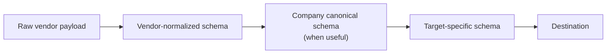

Not every integration needs `C`.

For example:

```text
Notion page
→ internal AI context
```

may remain vendor-specific.

But:

```text
Twenty Company
→ Company OS Company
→ ERPNext Customer
```

benefits from a canonical business object.

### Do not build one universal data model

Attempting to normalize every field in every business system will create an enormous abstraction that never quite fits.

Canonicalize high-value domains:

- Person.
- Company.
- Address.
- Product.
- Invoice.
- Project.
- Task.
- File/document.
- Employee.
- Event.

Allow extension fields:

```json
{
  "id": "...",
  "name": "...",
  "extensions": {
    "twenty": {
      "customRiskScore": 7
    }
  }
}
```

### Mapping definition

```yaml
apiVersion: companyos.io/mapping/v1
kind: Mapping

metadata:
  id: twenty-company-to-canonical
  version: 3

source:
  schema: connector://twenty/company/v2

target:
  schema: canonical://crm/company/v1

rules:
  - from: id
    to: externalIds.twenty

  - from: name
    to: name

  - expression: |
      source.address?.country ?? null
    to: address.country

  - expression: |
      normalizeDomain(source.domainName)
    to: websiteDomain
```

The mapping runtime should provide:

- Field mapping.
- Constants.
- Conditional expressions.
- Array operations.
- Date/time normalization.
- Currency/decimal handling.
- Lookup tables.
- Reference resolution.
- Controlled reusable functions.

For complex transformations, allow signed code-based transforms, but treat them as connector artifacts with the same security process.

Kaoto's current visual DataMapper work is worth studying/reusing for the mapping editor rather than starting its interaction design from scratch. citeturn2search3turn10view2

### Mapping tests

Every mapping version should support fixtures:

```yaml
tests:
  - name: normal-company
    input: fixtures/twenty-company.json
    expected: fixtures/company.expected.json

  - name: missing-address
    input: fixtures/twenty-company-no-address.json
    expected: fixtures/company-no-address.expected.json
```

Tests should include:

- Missing fields.
- `null`.
- Unicode.
- Timezones.
- DST boundaries.
- Decimal precision.
- Currency.
- Empty arrays.
- Very large strings/files.
- Unexpected vendor fields.
- Deleted fields.
- Schema-version upgrades.
- PII redaction.

### Browser automation fallback

Browser automation should be marked internally as a less reliable connector class.

```text
browserReliabilityClass: fallback
```

Every browser connector should declare:

```yaml
browser:
  allowedHosts:
    - legacy.example.com

  session:
    persistent: true
    maxAge: PT8H

  downloads:
    allowed: true
    maxSizeMb: 50

  uploads:
    allowed: false

  evidence:
    screenshotOnWrite: true
    traceOnFailure: true
```

Execution:

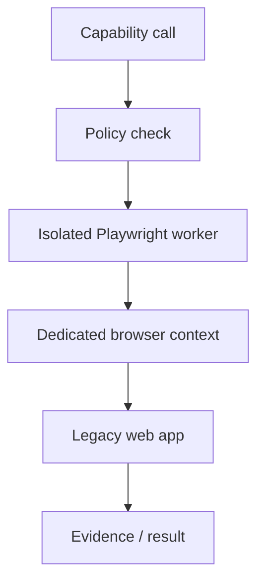

Rules:

- Ephemeral worker wherever possible.
- Dedicated browser context per connection.
- No shared cookies across tenants.
- Domain allowlist.
- Block access to cloud metadata and internal infrastructure.
- No unrestricted filesystem.
- Credentials injected only into the worker.
- Prefer deterministic locators and scripts over unconstrained AI clicking.
- Require stronger review for write operations.
- Capture screenshots/traces of important actions.
- Run synthetic tests regularly to detect UI breakage.

Playwright's current project also includes browser/agent interoperability and MCP-related tooling, but we should use its browser automation APIs as the fundamental primitive rather than couple business-critical integration logic to its agent layer. citeturn16search0turn16search4

## Observability, CI/CD, supply chain, SLAs, and upgrades

Integrations fail in more ways than ordinary application requests.

They depend on:

- Our software.
- Our network.
- Customer networks.
- Vendor networks.
- Vendor APIs.
- Credentials.
- OAuth consent.
- Vendor schema changes.
- Mapping versions.
- External quotas.
- Databases.
- Human approvals.

Observability therefore has to be part of the integration model.

### Correlation model

Every operation should carry:

```text
trace_id
correlation_id
run_id
step_run_id
tenant_id
portal_id
actor_id
workflow_id
connector_id
connector_version
connection_id
capability_id
idempotency_key
external_request_id
```

Example:

```json
{
  "traceId": "7f...",
  "correlationId": "customer_onboarding_982",
  "runId": "run_221",
  "stepRunId": "step_7",
  "tenantId": "tenant_a",
  "actorId": "ai_sales_9",
  "connectorId": "twenty",
  "connectorVersion": "1.4.0",
  "connectionId": "conn_17",
  "capability": "crm.company.create",
  "idempotencyKey": "tenant_a:run_221:step_7"
}
```

Use OpenTelemetry for distributed tracing/log/metric correlation and standard W3C trace propagation between services. OpenTelemetry's context propagation is designed to correlate distributed telemetry, and W3C Trace Context provides the standard `traceparent` mechanism for passing trace identity. citeturn13search0turn13search3turn13search6

Do not put:

- Passwords.
- Access tokens.
- Customer PII.
- Full document contents.

into trace baggage.

### Recommended telemetry

| Category | Metrics |
|---|---|
| Gateway | Requests, 4xx, 5xx, latency, blocked requests |
| Connections | Health, auth expiry, token-refresh failures |
| Connector | Success %, p50/p95/p99, retries |
| Vendor | 429 count, 5xx count, latency |
| Workflow | Running, completed, failed, waiting |
| Queue | Pending, age, redelivery, DLQ |
| CDC | Source lag, events/sec, last offset, schema errors |
| Batch | Rows/sec, bytes/sec, checkpoint |
| Browser | Login failures, selector failures, navigation errors |
| MCP | Tool discovery changes, call count, rejected tools |
| Policy | Allow, deny, require approval |
| Security | Invalid signatures, blocked egress, secret-access failures |

### Run trace UI

An engineer or customer administrator should see:

```text
RUN #882
Customer onboarding

09:00:01  Trigger received                    OK
09:00:01  Signature verified                  OK
09:00:01  Workflow started                    OK
09:00:02  Twenty: find company                OK  180 ms
09:00:02  ERPNext: create customer            OK  320 ms
09:00:03  Drive: create folder                RETRY
09:00:05  Drive: create folder                RETRY
09:00:10  Drive: create folder                OK
09:00:10  Human approval requested            WAITING
```

### Initial engineering SLOs

These are **recommended targets**, not claims about the underlying OSS projects.

| Service objective | Initial target |
|---|---:|
| Control-plane API monthly availability | 99.9% |
| Webhook durable-acceptance availability | 99.95% |
| Internal gateway/control overhead p95 | <250 ms |
| Webhook durable acknowledgement p95 | <2 seconds |
| JetStream event dispatch p95 | <2 seconds in healthy cluster |
| Normal CDC lag p95 | <10 seconds where source permits |
| Trace coverage for production runs | >99.9% |
| Missing actor attribution | 0 |
| Secret values in application logs | 0 |
| Undetected cross-tenant result | 0 |

External SaaS latency should be reported separately from our internal latency.

### Connector supply-chain model

Connectors are executable software with access to customer systems.

Treat each connector release like a product release.

```mermaid
flowchart LR
    CODE["Source"]
    TEST["Unit + contract tests"]
    SAST["Static/security checks"]
    SBOM["SBOM"]
    VULN["Vulnerability scan"]
    BUILD["OCI build"]
    SIGN["Cosign signature"]
    REG["Artifact registry"]
    CERT["Connector certification"]
    PROD["Production"]

    CODE --> TEST
    TEST --> SAST
    SAST --> SBOM
    SBOM --> VULN
    VULN --> BUILD
    BUILD --> SIGN
    SIGN --> REG
    REG --> CERT
    CERT --> PROD
```

Use **Syft** to generate CycloneDX/SPDX SBOMs. Syft is Apache-2.0 and supports SBOM generation from container images, filesystems and many package ecosystems. citeturn22search0

Use **Grype or an equivalent scanner** to scan images, filesystems and SBOMs against known vulnerabilities. citeturn22search1

Use **Cosign** for OCI artifact signing. Cosign is Apache-2.0, supports keyless/KMS-backed signing, and its project documentation explicitly recommends signing immutable image digests rather than mutable tags. citeturn22search2

Example deployment reference:

```text
BAD:
registry.companyos.io/connectors/twenty:latest

GOOD:
registry.companyos.io/connectors/twenty@sha256:b86d...
```

### Admission requirements

Production connector artifacts should be rejected unless:

```text
Manifest valid
AND
license permitted
AND
SBOM present
AND
artifact signed by approved publisher
AND
digest matches registration
AND
critical vulnerability policy passes
AND
integration tests pass
AND
capability declaration approved
```

### Runtime sandbox

Untrusted/third-party workers should have:

- Non-root user.
- Read-only root filesystem.
- Temporary writable volume only when necessary.
- Memory limit.
- CPU limit.
- Process limit.
- No host filesystem.
- No Docker socket.
- No Kubernetes credentials.
- Network egress allowlist.
- No ambient tenant secrets.
- Short-lived execution token.
- Seccomp/AppArmor or equivalent runtime policy.

### Activepieces import policy

Because Activepieces mixes MIT Community Edition with commercially licensed enterprise areas, importing code must have an automated path/license check. citeturn16search3

A piece is not production-approved just because its source is available.

Review:

```text
source license
dependency licenses
current vendor API
authentication
token scopes
rate limits
error handling
pagination
PII behavior
tests
```

### Upgrade strategy

Never auto-upgrade an integration engine immediately across the whole fleet.

Use:

```text
upstream release
    ↓
compatibility environment
    ↓
our regression suite
    ↓
security review
    ↓
internal canary
    ↓
1–5% tenant canary
    ↓
controlled rollout
    ↓
old runtime drained
```

**Camel:** remain on a supported LTS for production connector workers unless a newer feature line is specifically needed. Camel maintains upgrade recipes to assist migrations between release families. citeturn15search10

**APISIX:** read each release's breaking-change section. APISIX 3.17 explicitly includes compatibility-impacting changes in authentication, TLS and configuration behavior. citeturn19search0

**Temporal:** server and SDK upgrade compatibility must be tested independently of workflow code. The current 1.31 release line has GA Worker Deployment Versioning facilities, which can help stage worker-code updates. citeturn16search5

**Debezium:** preserve offsets and schema history through upgrades. Connector upgrades must be tested against the database version and schema being captured. Debezium explicitly requires persistent state for connector offsets and, for several databases, schema history. citeturn14search9

**SeaTunnel:** review incompatible-change documentation before upgrades rather than assuming job compatibility. citeturn2search32

**MCP:** store protocol version per server connection. MCP now has a formal evolving specification, so the broker must support protocol negotiation/adaptation rather than assuming today's transport will remain unchanged forever. The July 2026 release itself represents substantial transport/auth changes from earlier versions. citeturn20search5turn20search17

**Playwright:** browser engine versions move frequently; browser automations should therefore have automated regression runs against the runtime version being promoted. citeturn16search0

## Developer APIs, SDKs, flow definitions, and implementation tasks

The developer experience should expose **our abstraction**, regardless of whether Camel, Temporal or Playwright runs underneath.

### Public Integration Control Plane API

Recommended resource model:

| Endpoint | Purpose |
|---|---|
| `GET /v1/connectors` | Connector catalog |
| `GET /v1/connectors/{id}` | Connector detail |
| `GET /v1/connectors/{id}/versions` | Versions |
| `POST /v1/connections` | Create connection |
| `POST /v1/connections/{id}/verify` | Test connection |
| `POST /v1/connections/{id}/oauth/start` | Begin OAuth |
| `DELETE /v1/connections/{id}` | Revoke/remove |
| `GET /v1/connections/{id}/capabilities` | Enabled operations |
| `POST /v1/capabilities/{id}:execute` | Execute capability |
| `POST /v1/workflows` | Create flow |
| `POST /v1/workflows/{id}/versions` | Publish revision |
| `POST /v1/workflows/{id}:activate` | Activate |
| `POST /v1/workflows/{id}:pause` | Pause |
| `POST /v1/workflows/{id}/runs` | Start run |
| `GET /v1/runs/{id}` | Inspect run |
| `POST /v1/runs/{id}:cancel` | Cancel |
| `POST /v1/runs/{id}:retry` | Retry failure |
| `POST /v1/runs/{id}:replay` | Replay |
| `GET /v1/runs/{id}/steps` | Step trace |
| `POST /v1/mappings` | Create mapping |
| `POST /v1/mappings/{id}:test` | Test mapping |
| `POST /v1/mcp/connections` | Register MCP server |
| `POST /v1/mcp/connections/{id}:discover` | Discover tools/resources |
| `POST /v1/mcp/connections/{id}:approveChanges` | Approve tool changes |
| `GET /v1/events/subscriptions` | Event subscriptions |
| `POST /v1/webhook-endpoints` | Create incoming webhook |

### Capability execution API

Request:

```http
POST /v1/capabilities/crm.company.create:execute
Idempotency-Key: 90dd...

{
  "connectionId": "conn_twenty_01",
  "input": {
    "name": "Example AB",
    "domain": "example.se"
  },
  "context": {
    "customerId": "cust_221",
    "projectId": "proj_71"
  }
}
```

Response:

```json
{
  "runId": "run_842",
  "status": "succeeded",
  "output": {
    "id": "external_183",
    "name": "Example AB"
  },
  "external": {
    "system": "twenty",
    "requestId": "..."
  }
}
```

The caller should **not supply an authoritative tenant or actor ID in the body**. Those should come from the authenticated request context.

### Connector SDK

I recommend a **TypeScript SDK as the primary custom-connector SDK** because it matches the likely Company OS application stack and makes it easier to reuse selected Activepieces logic.

A Java/Camel adapter exposes the same contract for Camel components.

Conceptually:

```typescript
export interface ConnectorContext {
  readonly tenantId: string;
  readonly connectionId: string;
  readonly runId: string;
  readonly traceId: string;

  http: ScopedHttpClient;
  secrets: ExecutionSecretHandle;
  checkpoint: CheckpointStore;
  idempotency: IdempotencyService;
  events: EventEmitter;
  logger: RedactingLogger;
}

export interface Action<I, O> {
  definition: ActionDefinition;
  run(ctx: ConnectorContext, input: I): Promise<O>;
}

export interface Trigger<O> {
  definition: TriggerDefinition;
  start(
    ctx: TriggerContext,
    emit: (event: O) => Promise<void>
  ): Promise<void>;
}
```

The SDK's `http` object should enforce allowed hosts from the connector manifest.

Do not expose unrestricted:

```typescript
fetch(anyUrl)
```

to third-party connectors by default.

### SDK project types

```text
companyos-connector-sdk
├── HTTP/OpenAPI connector
├── webhook trigger
├── polling trigger
├── file trigger
├── database capability
├── Camel adapter
├── MCP adapter
├── Activepieces compatibility adapter
├── browser automation adapter
└── test harness
```

### Connector CLI

Engineers should have:

```bash
companyos connector init
companyos connector validate
companyos connector test
companyos connector test-auth
companyos connector test-webhook
companyos connector sbom
companyos connector build
companyos connector sign
companyos connector publish
```

### Local emulator

A developer should not need a production Company OS cluster to write a connector.

```bash
companyos dev connector ./connectors/acme
```

should provide fake:

- Tenant context.
- Secret broker.
- Idempotency service.
- Event bus.
- Checkpoint storage.
- Approval service.

### Integration test contract

Every production connector should pass standard tests:

```text
connect
authenticate
read
write
pagination
rate limit
timeout
token expiry
token revocation
bad input
provider 4xx
provider 5xx
duplicate request
network disconnect
schema variation
large response
PII logging
```

### Example flow definition

```yaml
apiVersion: companyos.io/workflow/v1
kind: IntegrationWorkflow

metadata:
  id: new-customer-onboarding
  version: 7

trigger:
  type: event
  event: crm.customer.created

steps:
  - id: lookup-erp-customer
    capability: erp.customer.search
    connection: "${connections.erp}"
    input:
      email: "${trigger.customer.email}"

  - id: create-if-missing
    if: "${steps.lookup-erp-customer.output.count == 0}"
    capability: erp.customer.create
    connection: "${connections.erp}"
    idempotencyKey: "${run.id}:erp-customer"
    input:
      name: "${trigger.customer.name}"
      email: "${trigger.customer.email}"

  - id: create-drive-folder
    capability: documents.folder.create
    connection: "${connections.drive}"
    idempotencyKey: "${run.id}:drive-folder"
    input:
      name: "${trigger.customer.name}"

  - id: request-approval
    type: approval
    when: "${trigger.customer.riskScore >= 8}"
    approverRole: customer-risk-manager

  - id: publish
    type: event
    event: customer.onboarding.started
```

Temporal can compile/execute the durable control logic while Camel/native workers perform the individual external capabilities.

### Example MCP exposure

The same capability can be exposed to AI through MCP:

```text
Native capability:
crm.company.search

MCP tool presented to permitted AI:
companyos.crm.company.search
```

The model sees only the schema and capability allowed by policy.

It does not receive:

- CRM API key.
- Vendor admin token.
- Database password.
- Internal connector endpoint.

### Example private database execution

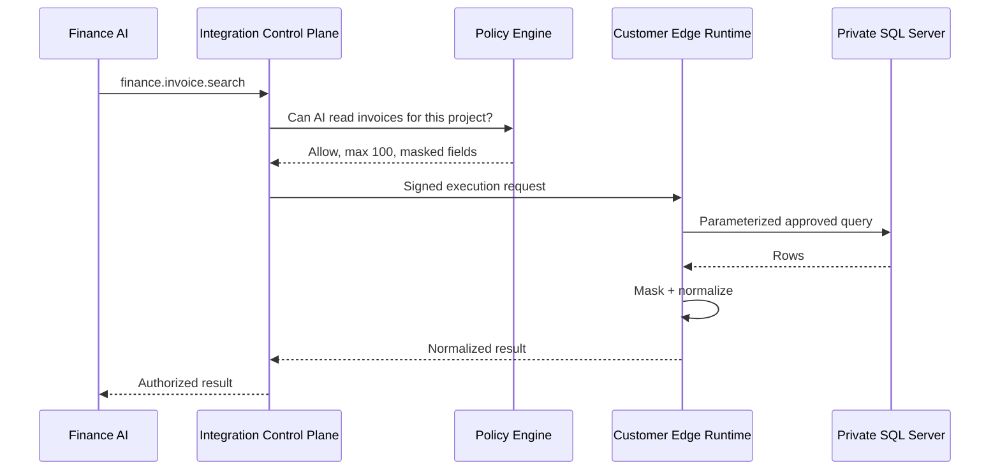

### ERPNext/Frappe adapter

Frappe currently generates REST endpoints for all DocTypes and supports RPC-style whitelisted methods, making an API-first ERPNext/Frappe connector practical. citeturn21search0turn21search1

The connector should support:

```text
doctype.search
doctype.read
doctype.create
doctype.update
method.call
webhook.subscribe/configure
```

but expose higher-level Company OS capabilities where stable semantics exist.

### Twenty adapter

Twenty currently exposes both REST and GraphQL APIs generated from the workspace schema, including custom objects, plus webhooks and OAuth. citeturn21search2turn21search4turn21search8

This makes Twenty useful for testing:

- REST.
- GraphQL.
- Dynamic schemas.
- Rate limits.
- Custom objects.
- Webhooks.
- OAuth/API-key patterns.

### Developer implementation workstreams

| Workstream | Main engineering tasks |
|---|---|
| Control Plane | Data model, API, versions, capabilities, connections |
| Security | Policy engine, execution tokens, secret broker |
| Gateway | APISIX configuration/control integration |
| Connector SDK | TS SDK, CLI, emulator, test harness |
| Camel runtime | Worker contract, route templates, health |
| Temporal | Workflow compiler/runtime, approvals, cancellation |
| Events | NATS/JetStream, schemas, outbox/inbox |
| MCP | Client broker, server exposure, discovery/governance |
| Edge Runtime | Registration, outbound control channel, updater |
| CDC | Debezium orchestration and normalization |
| Bulk | SeaTunnel job adapter |
| Browser | Playwright sandbox/worker |
| Mapping | Schema registry, mapping language/editor |
| Observability | OTel, run traces, metrics, alerting |
| Supply chain | Build/sign/scan/certification |
| UI | Connections, catalog, workflows, mapping, runs, incidents |

## Proof of concept, acceptance criteria, risk matrix, effort, and implementation checklist

The POC should prove the architecture, not merely demonstrate three successful API calls.

### Recommended POC topology

```text
Company OS Integration Control Plane
├── PostgreSQL
├── OPA
├── APISIX
├── Temporal
├── NATS JetStream
├── Camel workers
├── MCP Broker
├── connector registry
├── local encrypted secret provider
└── OpenTelemetry

Test systems
├── ERPNext / Frappe
├── Twenty
├── Gmail / Google Drive
├── remote PostgreSQL
├── Debezium
├── mock MCP server
└── mock legacy web app
```

SeaTunnel can be a separate POC track rather than a hard dependency of the first architecture demonstration.

### POC scenarios

| Scenario | What it proves |
|---|---|
| ERPNext read/write through REST | API connector |
| ERPNext signed webhook | Webhook ingress |
| Twenty REST query | REST |
| Twenty GraphQL query | GraphQL |
| Twenty custom object discovery | Dynamic schema |
| Gmail/Drive operation | OAuth cloud integration |
| Remote PostgreSQL read | JDBC |
| Remote DB write with constrained user | DB governance |
| Debezium PostgreSQL CDC | CDC |
| NATS event fan-out | Event backbone |
| Temporal approval wait | Durable workflow |
| MCP external tool discovery | MCP client |
| Company capability exposed via MCP | MCP server |
| Legacy test site through Playwright | Browser fallback |
| Worker running in edge network | Private integration |

Frappe supplies automatically generated DocType REST APIs and signed webhook support, so it is well suited for the API/webhook side of the POC. citeturn21search0turn21search11

Twenty exposes both REST and GraphQL against workspace-specific schemas, so it provides a useful second API style and dynamic-schema test. citeturn21search2

Camel's current catalog includes Google Mail and Google Drive components, allowing Gmail/Drive to exercise OAuth-oriented cloud connectivity without making those services core architectural dependencies. citeturn18search19

### Failure-injection test suite

The POC is not accepted until the following are exercised.

| Failure | Expected behavior |
|---|---|
| Connector process killed before API request | Automatic retry |
| Worker killed after external write but before local ack | No duplicate business effect |
| Same webhook sent 100 times | One logical effect |
| Provider returns 429 | Backoff, no DLQ yet |
| Provider returns permanent 400 | Immediate permanent failure |
| OAuth token expires | Refresh where allowed |
| OAuth connection revoked | Connection becomes unhealthy |
| Secret disabled | Execution blocked |
| NATS node restarted | Durable events continue |
| Temporal worker restarted | Workflow resumes |
| Edge runtime disconnected | Work waits/retries |
| Database inaccessible | Circuit opens after policy threshold |
| CDC service restarted | Resumes from durable offset |
| Duplicate CDC event | One downstream effect |
| Source schema adds field | Compatible handling |
| Source schema removes required field | Mapping failure/DLQ |
| MCP server adds destructive tool | Tool not automatically exposed |
| MCP server changes schema | Requires revalidation |
| Browser selector changes | Connector marked unhealthy |
| Cross-tenant ID injected | Access denied |
| AI attempts forbidden capability | Policy denies |
| Connector attempts unexpected network host | Egress denied |

### POC acceptance criteria

**Tenancy**

```text
0 confirmed cross-tenant data leaks
0 ability to use another tenant's connection
0 ability to access another tenant's credential
```

**Reliability**

```text
duplicate event tests produce one business effect
worker crash does not lose acknowledged business work
Temporal workflows resume after worker restart
CDC resumes from stored checkpoint
DLQ is inspectable and replayable
```

**Security**

```text
no secret in logs
no secret in traces
no raw long-lived credential reaches an AI prompt
network egress policy blocks unauthorized destinations
unsigned connector image cannot be deployed
MCP tool changes do not bypass approval
```

**Observability**

```text
>99.9% of POC integration runs have a complete correlation path
every failed run identifies failing connector and step
external provider request IDs are retained when available
```

**Developer experience**

```text
new basic REST connector can be created using SDK template
connector can be tested locally
manifest validation is automatic
SBOM generated automatically
signed artifact promoted automatically after tests
```

### Suggested POC timeline

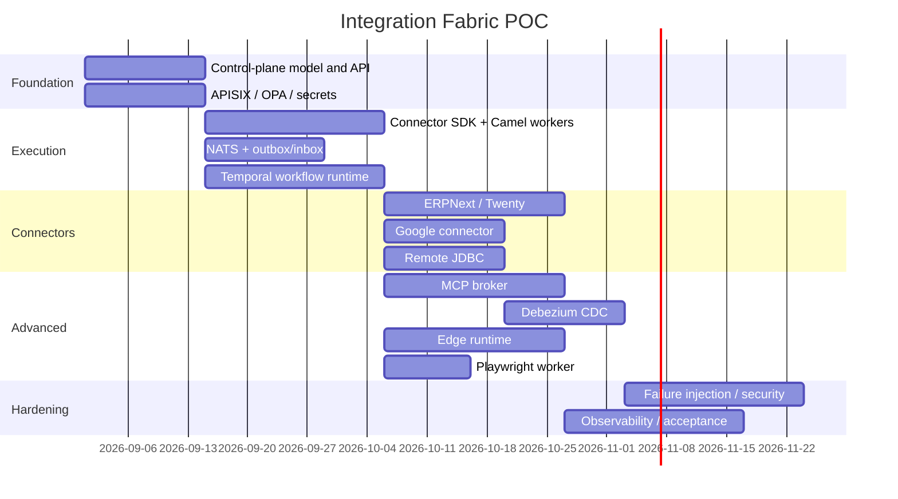

The dates are illustrative; the important point is the dependency order.

### Estimated engineering effort

These are planning estimates, not promises.

| Stage | Team | Calendar estimate | Person-effort |
|---|---|---:|---:|
| Architectural spike | 2–3 senior engineers | 2–3 weeks | 5–8 person-weeks |
| Credible POC | 5–7 engineers | **10–14 weeks** | **50–80 person-weeks** |
| Hardened internal alpha | 7–9 engineers | additional 3–4 months | 100–150 person-weeks |
| Production v1 integration fabric | 8–12 engineers + SRE/security | **6–9 months total after POC direction is validated** | **220–380 person-weeks** |
| Broad enterprise integration platform | 10–15 engineers | 12–18 months | **450–800+ person-weeks** |

These estimates exclude building hundreds of polished vendor connectors.

Using Camel and selectively adapting Activepieces connectors should reduce connector-development effort substantially, but **every imported connector still needs recertification**.

### Principal risks

| Risk | Probability | Impact | Mitigation |
|---|---|---|---|
| Cross-tenant data leakage | Medium | **Critical** | Signed tenant context, worker isolation, policy tests |
| Credential leakage | Medium | **Critical** | Secret broker, redaction, no prompt credentials |
| Third-party connector compromise | Medium | **Critical** | SBOM, signing, sandbox, egress controls |
| Direct DB write damages customer system | Medium | **Critical** | Read-only default, approved capabilities, transactions |
| Duplicate side effects | High | High | Idempotency, inbox/outbox, reconciliation |
| Vendor API breaking changes | High | Medium–High | Versioned connectors, contract tests, canaries |
| MCP tool changes expand authority | High | High | Tool snapshots and reapproval |
| MCP malicious descriptions/tool metadata | Medium | High | Treat metadata as untrusted, local risk classification |
| CDC duplicate/change ordering issue | Medium | High | Idempotency, partition ordering, durable offsets |
| CDC schema drift | High | Medium–High | Schema registry, compatibility tests, DLQ |
| Browser UI changes | **Very high** | Medium–High | Last-resort status, health tests, evidence |
| Integration infrastructure becomes too complex | Medium | High | Do not deploy specialist engines until required |
| Temporal lock-in in workflow definitions | Medium | Medium | Keep Company OS workflow DSL independent |
| Camel route logic becomes business logic | Medium | High | Camel only executes connector operations |
| Activepieces license boundary accidentally crossed | Medium | High | Automated path/license scanning |
| Customer firewall prevents cloud worker access | High | High | Edge Runtime |
| Event “exactly once” assumption is wrong | High | High | Design for at-least-once and idempotency |

### Recommended production rollout order

The architecture should be implemented incrementally:

```text
FIRST
Integration Control Plane
APISIX
OPA
Connector contract
Secrets abstraction
Camel
REST/OpenAPI
Webhooks
JDBC
NATS JetStream
ERPNext + Twenty

        ↓

SECOND
Temporal
MCP Broker
Google/Microsoft cloud connectors
Email
SFTP/SMB
Edge Runtime
Mapping framework

        ↓

THIRD
Debezium CDC
Advanced SOAP/gRPC
Connector marketplace/import pipeline
Kaoto-derived visual tools

        ↓

WHEN REQUIRED
SeaTunnel
High-volume streaming infrastructure
Playwright legacy automation
Dedicated tenant execution clusters
```

This avoids repeating the problem seen in Open Integration Hub: deploying a large collection of infrastructure services before actual customer workloads require all of them.

### Implementation checklist

| Area | Required before production |
|---|---|
| **Architecture** | ☐ Control plane independent from execution engines |
| | ☐ Stable Company OS Capability model |
| | ☐ Connectors and connections separated |
| | ☐ Flow model independent of Temporal |
| **Tenancy** | ☐ Server-derived tenant context |
| | ☐ No caller-controlled authoritative tenant IDs |
| | ☐ Cross-tenant automated attack tests |
| | ☐ Per-tenant connection ownership |
| **AI governance** | ☐ Human/AI/service principal differentiation |
| | ☐ AI capability limits |
| | ☐ Delegation chain |
| | ☐ Approval gates for high-risk actions |
| **Secrets** | ☐ KMS/envelope encryption |
| | ☐ Secrets referenced, never stored in manifests |
| | ☐ OAuth rotation/revocation |
| | ☐ No credentials in prompts/logs/events |
| **Connectors** | ☐ Versioned connector manifests |
| | ☐ JSON Schema inputs/outputs |
| | ☐ Side-effect classification |
| | ☐ Idempotency declaration |
| | ☐ Rate-limit declaration |
| | ☐ Network egress declaration |
| **Runtime** | ☐ Camel execution provider |
| | ☐ Temporal durable provider |
| | ☐ JetStream durable events |
| | ☐ Execution cancellation/timeouts |
| | ☐ Circuit breakers |
| **Reliability** | ☐ Transactional outbox |
| | ☐ Consumer inbox/dedupe |
| | ☐ Retry taxonomy |
| | ☐ DLQ |
| | ☐ Manual replay |
| | ☐ Ambiguous-write reconciliation |
| **MCP** | ☐ Current protocol support |
| | ☐ OAuth/resource validation |
| | ☐ Server/tool snapshots |
| | ☐ Tool-change review |
| | ☐ Risk classification independent of server metadata |
| | ☐ No token passthrough |
| | ☐ stdio servers sandboxed |
| **Database** | ☐ Read-only default |
| | ☐ Schema/table allowlists |
| | ☐ Parameterized capabilities |
| | ☐ Query timeout |
| | ☐ Dedicated database identity |
| **CDC** | ☐ Durable offsets |
| | ☐ Durable schema history |
| | ☐ Sensitive field filtering |
| | ☐ Duplicate-event testing |
| | ☐ Schema-drift handling |
| **Edge Runtime** | ☐ Outbound-only connectivity option |
| | ☐ mTLS/device identity |
| | ☐ Remote revoke |
| | ☐ Signed updates |
| | ☐ Local execution isolation |
| **Browser** | ☐ Isolated Playwright workers |
| | ☐ Domain restrictions |
| | ☐ Separate browser contexts |
| | ☐ Screenshot/trace evidence |
| | ☐ Automated health regression |
| **Mapping** | ☐ Immutable mapping versions |
| | ☐ Fixtures and golden tests |
| | ☐ Schema compatibility |
| | ☐ Currency/date/timezone testing |
| **Observability** | ☐ OpenTelemetry |
| | ☐ Correlation IDs |
| | ☐ Run/step trace UI |
| | ☐ Vendor IDs captured |
| | ☐ Queue/CDC/browser metrics |
| **Supply chain** | ☐ SBOM |
| | ☐ Vulnerability scan |
| | ☐ Licence scan |
| | ☐ OCI digest pinning |
| | ☐ Cosign signature verification |
| | ☐ Egress policy |
| **Upgrade** | ☐ Connector canary mechanism |
| | ☐ Runtime compatibility suite |
| | ☐ Rollback |
| | ☐ Temporal worker-version strategy |
| | ☐ MCP protocol-version compatibility |

The final architectural principle should be kept very strict:

```text
                  COMPANY OS

      knows companies, humans, AI employees,
      scopes, roles, authority and business meaning

                       │
                       ▼

           INTEGRATION CONTROL PLANE

     knows capabilities, connections, policies,
     mappings, flows, runs and external identities

                       │
                       ▼

              EXECUTION PROVIDERS

 Camel │ Temporal │ NATS │ MCP │ Debezium │ SeaTunnel │ Playwright

                       │
                       ▼

                 ANY SYSTEM

 API │ DB │ MCP │ SOAP │ GraphQL │ gRPC │ Mail │ SFTP │ SMB
 Cloud │ Webhook │ Queue │ CDC │ Files │ Browser
```

**Camel, Temporal, NATS, Debezium, APISIX and MCP are infrastructure. The strategic product is the governed semantic layer above them.**

That is what allows the Company OS to remain stable when one customer uses Twenty and ERPNext, another uses Salesforce and SAP, another uses Notion and Microsoft 365, and another still runs a fifteen-year-old SQL database and exchanges invoices through SFTP.

The Company OS should see **capabilities and company authority**.

The integration fabric should absorb the technical differences.