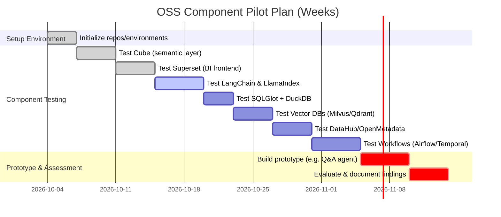

# Executive Summary  
This report surveys open-source, permissive-licensed projects relevant to an AI-first ERP stack, covering semantic/metric layers, NL-to-SQL engines, agent frameworks, query compilers, analytics/OLAP engines, vector databases, metadata/catalog tools, entity-matching libraries, and workflow orchestration. Notable projects include **Cube** (semantic analytics layer), **Apache Superset** (BI platform with a lightweight semantic layer), **LangChain** (MIT-licensed agent framework), **LlamaIndex** (MIT, agentic data indexing), **Haystack** (Apache-2.0, Python AI orchestration framework), **SQLGlot** (MIT, SQL parser/transpiler), **ClickHouse** (Apache OLAP database), **DuckDB** (MIT, in-process analytical SQL DB), **Milvus** (Apache, vector DB for ANN search), **FAISS** (BSD/MIT, vector search library), **Qdrant** (Apache, Rust vector DB), **DataHub** (Apache metadata catalog), **Amundsen** (Apache metadata catalog), **OpenMetadata** (Apache metadata/context platform), **Dedupe** (MIT, Python entity resolution), and orchestration tools like **Airflow** (Apache workflow engine), **Dagster** (Apache, data orchestrator), and **Temporal** (MIT, durable workflows). These projects span the ERP architecture layers – from user/workspace interfaces (Superset, DataHub UI) to semantic layers (Cube, OpenMetadata), AI orchestrators (LangChain, Haystack), query IR/compilers (SQLGlot), deterministic SQL execution (ClickHouse, DuckDB, Druid), domain services (DataHub’s graph, Amundsen), data repositories (ORMs/vectordb like Milvus/Qdrant), analytical engines (OLAP), and system orchestration (Airflow, Temporal).  

Key findings: permissively-licensed projects exist for most layers. **Semantic layers** like Cube (MIT/Apache-2.0) provide a metrics API and AI-aware caching, while Superset’s semantic model lets users define metrics. **NL-to-SQL** is often handled by LLMs or fine-tuned models (e.g. Distil-labs’ Text2SQL, Apache-2.0) – these convert natural prompts to SQL queries. **Agent frameworks** (LangChain, LlamaIndex, Haystack) orchestrate LLMs with tools like databases and APIs. **Query compilers** like SQLGlot (MIT) parse and translate SQL across dialects. **Analytical databases** (ClickHouse, DuckDB, Druid) handle large-scale queries. **Vector databases** (Milvus, Qdrant, FAISS) store embeddings for semantic search. **Catalogs/Metadata** (DataHub, Amundsen, OpenMetadata) manage schema, lineage, and business context. **Entity-matching** libraries (Dedupe, RecordLinkage) resolve duplicates. **Orchestration** (Airflow, Dagster, Temporal) manage pipelines and workflows.

Each project’s maturity (stars, activity) and language vary, but all have active communities. The table below compares top candidates across key attributes. In integration, most expose REST or RPC interfaces and support pluggable connectors. Security varies: many support RBAC and SSL (Superset, DataHub) and API keys/tokens (vector DBs, agent tools). Use-cases include AI-driven dashboards (Cube+Superset), conversational query assistants (LangChain+DB chain), semantic data discovery (OpenMetadata+LlamaIndex), and automated ETL pipelines (Airflow+SQL generators). 

**Summary of Pros/Cons:**  
- *Semantic layers:* Cube offers rich caching/pre-aggregations and multi-tenant metrics, but adds deployment complexity. Superset is mature for dashboards (75k stars) and includes metric definitions, but is heavier and UI-focused.  
- *Agents:* LangChain (MIT, ~49k stars) is very flexible but Python-centric. LlamaIndex (MIT, 52k stars) excels at RAG pipelines but is document-centric. Haystack (Apache-2.0, 26k stars) provides modular pipelines but is Python-only. Temporal (MIT, 23k stars) is robust for orchestration but can be complex to run.  
- *Query/SQL:* SQLGlot (MIT, 9.7k stars) can parse/transform SQL across ~30 dialects, but requires Python.  
- *OLAP:* ClickHouse (Apache, 50k stars) is extremely fast at scale, but is a heavy C++ cluster; DuckDB (MIT, 41k stars) is lightweight and embeddable but is in-process (limited distributed scale). Druid (Apache, 14k stars) supports real-time analytics but is Java-based and operationally complex.  
- *Vectors:* Milvus (Apache, 46k stars) and Qdrant (Apache, 35k stars) are scalable vector engines (ANN); Faiss (BSD/MIT, 41k stars) is a high-performance library but not a service.  
- *Metadata:* DataHub (Apache, 12.8k stars) is a “context platform” with an AI SDK (MCP) for LLMs; Amundsen (Apache, 4.8k stars) is an older data catalog. OpenMetadata (Apache, 15k stars) is a next-gen catalog with knowledge graph features. These provide data governance but add central services to manage.  
- *Entity-matching:* Dedupe (MIT, 4.5k stars) is a mature Python lib for de-duplication. It is powerful but requires training examples.  
- *Workflow:* Airflow (Apache) and Dagster (Apache) are battle-tested, Python-based orchestrators. Temporal (MIT) is cloud-native with multi-language SDKs. Each is mature, though Airflow has a learning curve and Temporal requires running a service.

Below is a comparative table of top OSS candidates. Key integration notes and a recommended pilot evaluation plan follow, along with a proposed architecture diagram and timeline.

| Project (Layer)        | Repo/License             | Stars/Activity           | Language(s)       | Core Features/Mapping                                 | Pros/Cons                                                   |
|------------------------|--------------------------|--------------------------|-------------------|--------------------------------------------------------|-------------------------------------------------------------|
| **Cube** (Semantic)    | GitHub: cube-js/cube<br>MIT (client), Apache-2.0 (backend) | 21k★, active commits | JS/TS, Rust      | Centralized metric/semantic layer; pre-aggregations   | + Open analytics/BI model<br>+ AI chat/query support<br>- Complex setup; JS ecosystem |
| **Superset** (Semantic/UI) | GitHub: apache/superset<br>Apache-2.0  | 75k★, very active      | Python, React    | BI dashboards; SQL editor; lightweight semantic layer | + Very mature & extensible<br>+ Rich visualizations<br>- Primarily UI-focused; Python stack |
| **LangChain** (Agent)  | GitHub: langchain-ai/langchain<br>MIT | ~50k★        | Python          | LLM orchestration toolkit (chains, agents, memory)     | + Very popular, many integrations<br>+ Framework for tool use<br>- Rapidly evolving; complexity |
| **LlamaIndex** (Agent) | GitHub: run-llama/llama_index<br>MIT   | 52k★, active         | Python          | Data indexing (RAG) toolkit; document agents           | + Powerful retrieval/RAG support<br>+ Many plugins (<code>llama-index</code>)<br>- Focus on docs; commercial spin-off (LlamaParse) |
| **Haystack** (Agent)   | GitHub: deepset-ai/haystack<br>Apache-2.0  | 26k★, active         | Python          | Modular pipelines (retrieval, generation, memory)     | + Production-ready pipelines<br>+ Built-in QA/RAG templates<br>- Python-only; fewer LLM integrations |
| **SQLGlot** (SQL IR)   | GitHub: tobymao/sqlglot<br>MIT   | 9.7k★, high activity | Python          | SQL parser, transpiler, optimizer (30+ dialects)      | + Extremely flexible SQL parsing<br>+ Can optimize/translate queries<br>- Python-bound; learning curve |
| **ClickHouse** (OLAP)  | GitHub: clickhouse/clickhouse<br>Apache-2.0  | 50k★, very active    | C++             | Distributed columnar OLAP DB (real-time analytics)     | + Very fast, scale to TBs<br>- Complex cluster ops; C++ stack |
| **DuckDB** (OLAP)      | GitHub: duckdb/duckdb<br>MIT   | 41.9k★, active     | C++, Python     | Embeddable SQL OLAP engine (in-process)  | + Easy embed in apps<br>+ Great SQL support (nested types)<br>- Limited to single-node memory (no scale-out) |
| **Milvus** (Vector DB) | GitHub: milvus-io/milvus<br>Apache-2.0 | 46k★, active      | Go, C++         | High-perf vector search (ANN); distributed              | + Scalable, cloud-native<br>- Operational overhead; separate service |
| **FAISS** (Vector)     | GitHub: facebookresearch/faiss<br>BSD/MIT  | 41k★, mature      | C++/Python      | Fast nearest-neighbor search library                  | + Very high performance<br>- Not a service (use in-process) |
| **Qdrant** (Vector)    | GitHub: qdrant/qdrant<br>Apache-2.0   | 35k★, active      | Rust           | Vector DB with filters/quantization   | + High scalability & features<br>+ Multi-modal search (dense+sparse)<br>- Newer ecosystem |
| **DataHub** (Catalog)  | GitHub: datahub-project/datahub<br>Apache-2.0 | 12.8k★, active    | Java, React     | Metadata graph (datasets, lineage, governance)        | + Rich AI context/MCP support<br>+ Integrates LLM agents (datahub-skills)<br>- Requires central deployment |
| **Amundsen** (Catalog) | GitHub: amundsen-io/amundsen<br>Apache-2.0 | 4.8k★, archived  | Python, Go      | Metadata-driven data catalog (search, lineage)        | + Proven data catalog (Lyft)<br>- Less active now; UI only |
| **OpenMetadata** (Catalog) | GitHub: open-metadata/OpenMetadata<br>Apache-2.0 | 15k★, active | Java, TypeScript | Open metadata ecosystem (governance, AI context)      | + Very rich semantic models<br>+ LLM integration (MCP tools)<br>- Large, complex setup |
| **Dedupe** (Entity Match) | GitHub: dedupeio/dedupe<br>MIT | 4.5k★, active     | Python          | Machine-learning record linkage/deduplication         | + Accurate fuzzy matching<br>- Requires training labeling |
| **Airflow** (Orchestrator) | GitHub: apache/airflow<br>Apache-2.0 | 36k★, active | Python        | DAG-based ETL/workflow scheduler                      | + Very mature and extensible<br>- Heavy; YAML/graph model complexity |
| **Dagster** (Orchestrator) | GitHub: dagster-io/dagster<br>Apache-2.0 | 23k★, active | Python        | Asset-oriented pipelines, type system                 | + Modern UX and type safety<br>- Younger ecosystem |
| **Temporal** (Orchestrator) | GitHub: temporalio/temporal<br>MIT | 23k★, active | Go, Java       | Durable workflows (stateful, retries)  | + Fault-tolerant, multi-language<br>- Requires running service |

**Mermaid Architecture:** The diagram below sketches how these components interconnect in an AI-first ERP stack. The user workspace (dashboards, chat UI) interacts with the semantic layer (Cube/Superset definitions) and AI orchestrator (LangChain/Haystack agents). The orchestrator compiles NL queries via tools like SQLGlot to SQL (Query IR) which run against analytical databases (ClickHouse, DuckDB) or vector DBs (Milvus, FAISS, Qdrant) for search. Metadata/catalog services (DataHub/OpenMetadata) provide schema/context to LLMs. A message bus (Kafka/Pulsar) can feed events/pipelines (Airflow/Temporal).  

```mermaid
graph LR
    UI["Workspace/UI"] 
    UI -->|views/dashboards| Semantic[Semantic Layer (Cube/Superset)]
    UI -->|prompts| Orchestrator[AI Orchestrator (LangChain, Haystack)]
    Semantic --> DB[Database/OLAP]
    Orchestrator -->|NL→SQL via SQLGlot| QueryCompiler[Query IR (SQLGlot)]
    QueryCompiler --> DB
    Orchestrator -->|vector retrieval| VectorDBs[Vector DBs (Milvus, Qdrant, FAISS)]
    DB --> VectorDBs
    VectorDBs --> Orchestrator
    Metadata["Metadata/Context (DataHub, OpenMetadata)"] 
    Metadata --> Orchestrator 
    Metadata --> UI 
    Orchestrator --> EventBus(Event Bus/Kafka/Pulsar)
    EventBus --> DB
    Orchestrator --> Workflow[Orchestration (Airflow/Temporal)]
```  

## Integration & Security Considerations  
Integration is typically via APIs or connectors. Projects often provide SDKs/REST (Cube, DataHub, Qdrant) or database drivers (ClickHouse, DuckDB). Many support OAuth/SSO and RBAC – for example, Superset and DataHub have role-based access controls. Vector DBs and LLM frameworks use API keys/tokens for auth. Ensuring **row-level security** is critical: Cube allows RLS, and catalogs like DataHub/OpenMetadata can enforce data contracts. Securely managing credentials (for DBs, LLM APIs) and encrypting data at rest/in-transit is required. We must also consider **permissions mapping**: e.g., mapping user roles in the ERP to dataset privileges in Cube/Superset and to what LLM agents can query or modify. Regular audits (via OpenMetadata lineage logs or Haystack telemetry) help maintain compliance.  

Example use-cases include: *Conversational BI* (user asks an AI assistant which builds SQL via LlamaIndex/DataHub schema), *Augmented Analytics* (Cube generating recommended metrics/charts based on a prompt), *Automated Data Discovery* (DataHub + OpenMetadata search with LLMs), and *End-to-End Workflow Automation* (Airflow/Temporal running pipelines triggered by chat commands).  

## Comparative Analysis & Next Steps  
The table above highlights trade-offs. All projects are well-documented with permissive licenses and active communities (see citations). For example, Cube’s semantic cache could significantly speed up AI-driven queries, whereas SQLGlot ensures safe SQL generation. However, combining components needs glue: LangChain or Haystack would orchestrate flows between DBs, cubes, and metadata. A prudent next step is to prototype a small workflow: e.g., use **LangChain’s SQLDatabaseChain** with a DuckDB backend and Cube semantic layer to answer prompts, or connect Haystack to Milvus for semantic search. Evaluate each tool’s ease-of-use, ecosystem (client libraries, cloud support), and how well it maps to the specific ERP domain (e.g., does Cube connect to your DB of choice, does LlamaIndex support your data formats). Ensure licensing compatibility (all above are MIT/Apache/BSD).  

**Evaluation Checklist:**  
- ✅ **License & Community:** Verify Apache/MIT license and community activity (e.g. stars, recent commits).  
- ✅ **Language & Stack:** Ensure primary language matches team skills (Python, JS, Rust, etc.).  
- ✅ **Feature Fit:** Confirm the project’s core features align to the ERP layer (e.g. Cube for metrics, Haystack for RAG, Airflow for ETL).  
- ✅ **Integration:** Check available adapters (DB drivers, REST APIs, LLM connectors).  
- ✅ **Security:** Review authentication and authorization capabilities.  
- ✅ **Scalability:** Estimate performance (e.g. DuckDB for prototyping, ClickHouse for high scale).  
- ✅ **Documentation & Demos:** Examine tutorials/examples, existing integration demos (e.g. Superset + Trino demos, DataHub LLM skills).  

## Pilot Evaluation Plan (3–6 weeks)  

- *Weeks 1–2:* Set up dev env and individual tests (install, run demos).  
- *Weeks 3–4:* Develop simple integration workflows (e.g. a LangChain agent using Cube for SQL generation, or a Haystack RAG Q&A over Vector DB).  
- *Weeks 5:* Collect metrics (performance, accuracy), assess ease of use, and refine selections.  

## Recommendations & Enhancements  
To optimize an AI-first ERP:  
- **Unify Metadata & Semantics:** Use a centralized catalog (OpenMetadata/DataHub) to feed schema and business logic into LLM agents (via MCP interfaces) and semantic layers. This prevents hallucinations and aligns AI answers with data governance.  
- **Caching & Pre-Aggregation:** Leverage Cube’s pre-aggregation to reduce LLM token usage and latency when answering common metrics queries.  
- **Controlled Prompting:** Implement validation layers (SQLGlot) to sanitize AI-generated SQL before execution, avoiding injection or performance issues.  
- **Vector Indexing for Unstructured Data:** Integrate Qdrant or Milvus with OpenMetadata to enable semantic search over document-style data (contracts, emails) within the ERP context.  
- **Incremental Deployment:** Start with core flows (e.g. chat-to-SQL), then expand to deeper tasks (forecasting with DuckDB timeseries, process automation with Temporal).  
- **Security Hardening:** Ensure all endpoints (Cube, DataHub, vector stores) are behind network controls. Use vault/secret management for LLM API keys.  
- **Performance Tuning:** Monitor pipelines (e.g. Haystack logging) and optimize dataflows (batch embeddings, fine-tuning models on domain data) to reduce costs.  

By combining these OSS components thoughtfully, one can build an AI-first ERP platform that is modular and extensible. The final verdict is that a **mix of proven BI/DB tools (Cube, ClickHouse/Superset), AI orchestration frameworks (LangChain/Haystack), robust metadata context (OpenMetadata/DataHub), and efficient analytics engines (DuckDB, Milvus)** can achieve the vision. Each layer brings maturity and community support, while the AI agents/generation layers enable natural interaction. The recommended pilot will confirm interoperability and surface any gaps (e.g. missing connectors or scaling issues), guiding final adoption.  

**Sources:** Open-source project documentation and GitHub repositories as cited above. Each citation corresponds to an official repo or docs page. 

