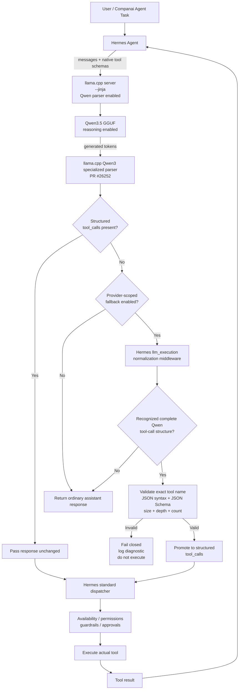

# Qwen3.5 → llama.cpp → Hermes Tool-Call Reliability Research Report

## Executive summary

**The situation has materially improved since the document we discussed earlier. There is now an upstream llama.cpp fix specifically aimed at the Qwen3.5 reasoning/tool-call problem.** On **August 2, 2026**, llama.cpp merged PR **#26252, “chat: add qwen3 specialized parser.”** It explicitly supersedes the earlier proposed parser PR #24202 and changes Qwen parsing so that `<tool_call>` can terminate a reasoning section and be recognized as a real tool call instead of remaining trapped in `reasoning_content`. The PR was tested with **Qwen3.5-9B with reasoning enabled**, including tool calls before `</think>`, reordered arguments, multiple calls, and a complete tool loop. citeturn18view0turn17view1

That changes my recommendation from the earlier document. **I would no longer make “disable reasoning for local Qwen” the default Companai workaround.** I would first upgrade to a recent llama.cpp build containing PR #26252, keep reasoning enabled, run a qualification suite against your exact GGUF and Hermes configuration, and disable reasoning only as a rollback if that combination still fails. As of **August 14, 2026**, llama.cpp's latest published release is **b10426**, substantially newer than the August 2 merge; Hermes Agent's latest tagged release is **v0.20.1 / v2026.8.13**, released August 13. citeturn21view0turn22view0

The upstream fix is particularly relevant because it attacks the problem at the correct boundary:

```text
Qwen generated tokens
        ↓
llama.cpp Qwen-specific parser     ← PR #26252 fixes this layer
        ↓
OpenAI-compatible structured response
        ↓
message.tool_calls[]
        ↓
Hermes
        ↓
validation / authorization / execution
```

This is preferable to teaching Hermes to reinterpret arbitrary assistant text. Hermes maintainers have repeatedly rejected a generic core-level `content → tool_calls` recovery layer, including PR #35129, on the grounds that provider-format violations belong at the provider/compatibility layer and that broad text scraping creates an injection surface. citeturn6view0turn24view4

However, **I would not yet declare the entire Qwen3.5 → llama.cpp → Hermes problem permanently solved.** The merged parser handles the principal failure reported in #20837/#22684, but other failure classes have existed: natural-language text before a tool marker causing PEG failures, omitted wrappers, malformed model output, streaming/channel incompatibilities, and clients failing to preserve reasoning state over subsequent tool turns. Some related llama.cpp issues remain open, and the superseded parser discussion itself records cases where client behavior caused additional interruptions even after parser improvements. citeturn18view2turn18view4turn17view1

There is also a real standalone salvage library, **MUSE-CODE-SPACE/toolcall-rescue**, created by the author of the rejected Hermes content-promotion PR. It recognizes several plain-text tool-call formats and deliberately runs only when the structured `tool_calls` field is empty. It has useful security controls such as exact tool-name gating, deduplication, fail-closed behavior and a kill switch. But the repository still describes its PyPI release as “imminent,” so I would regard it as a useful implementation/reference component rather than a mature dependency on which Companai should blindly rely. citeturn23view2turn24view3turn24view4turn24view6

My recommended Companai architecture is therefore **defense in depth**:

> **Primary fix:** current llama.cpp Qwen-specific parser → **secondary compatibility layer:** narrowly scoped Hermes `llm_execution` middleware → **existing Hermes validation/approval/execution pipeline**.

The middleware should normally do nothing. It activates only when all of these are true: the configured provider is the local Qwen/llama.cpp provider; llama.cpp returned no structured `tool_calls`; the text contains one of a small set of structurally valid Qwen tool-call envelopes; the tool name exactly matches a tool actually exposed in that request; and its arguments validate against that tool's JSON Schema. Hermes' current plugin middleware architecture provides an appropriate `llm_execution` seam for wrapping a provider call without modifying Hermes core. citeturn13view0turn13view1

**Bottom-line recommendation for the project document:** replace the old statement that Qwen reasoning should be disabled with:

> **Use a current llama.cpp build containing the merged Qwen3 specialized parser (#26252) and keep Qwen reasoning enabled by default. Qualify the exact Qwen GGUF + llama.cpp + Hermes combination with repeated tool-loop tests. Retain reasoning-off as an immediate compatibility rollback, and optionally deploy a strict provider-scoped tool-call normalization middleware as defense in depth.**

That is now the most accurate description of the state of the ecosystem as of August 14, 2026. citeturn18view0turn21view0turn22view0


## What is actually failing

The core issue is easier to reason about if Qwen's **model protocol**, llama.cpp's **parser/API layer**, and Hermes' **agent execution layer** are kept separate.

Qwen's official documentation describes function calling as the application supplying tool definitions to the model, the model choosing a function and arguments, and the application executing it. Qwen explicitly recommends **Hermes-style tool use** for Qwen3. Qwen's own supported serving example uses vLLM with `--tool-call-parser hermes`, which demonstrates that an inference server/parser is expected to translate model-generated syntax into structured API tool calls. citeturn24view7

llama.cpp performs that translation itself when running `llama-server`. Its function-calling documentation says OpenAI-style function calling is provided through the Jinja chat mechanism; current server documentation has `--jinja` enabled by default and exposes controls for parsing tool calls and reasoning separately. citeturn23view0turn24view0

The important distinction is therefore:

```text
Qwen-level representation
<tool_call> ... </tool_call>

                 ↓ parser

OpenAI API-level representation
message.tool_calls = [
    {
        "id": "...",
        "type": "function",
        "function": {
            "name": "...",
            "arguments": "..."
        }
    }
]
```

**Hermes should normally receive the second representation, not be responsible for guessing that the first representation embedded in prose was intended for execution.**

### The observed failure modes

| Failure mode | What the model/backend does | What Hermes effectively sees | Evidence |
|---|---|---|---|
| Tool call swallowed by thinking | Qwen emits a valid `<tool_call>` while the parser still considers itself inside reasoning | `reasoning_content` contains the call; `tool_calls` is empty | llama.cpp #20837 and #22684 documented exactly this behavior. citeturn18view1turn18view3 |
| Reasoning-like text precedes the call | Qwen produces text between reasoning termination and `<tool_call>` | PEG grammar can reject the completion rather than promoting it | Qwen3.5-35B-A3B issue #20260 demonstrated this parser failure. citeturn18view2 |
| Tool wrapper is omitted | The model emits `<function=...>` / arguments / `</tool_call>` without the expected opening marker | Parser may regard the whole response as content | The #24202 discussion documented this; #26252 added tolerance for older Qwen variants omitting the start wrapper in supported contexts. citeturn17view1turn18view0 |
| Raw call lands in ordinary `content` | Tool syntax survives as assistant text instead of `tool_calls[]` | Hermes sees a normal assistant response | This is the class of problem behind Hermes issues/proposals #741, #5867 and #29115. citeturn2search0turn2search1turn2search2 |
| Tool call is structured correctly but conversation state is reconstructed incorrectly | A client does not feed required reasoning/history state back into the subsequent turn | Later tool-loop turns become unstable or stop | llama.cpp contributors explicitly discussed clients that do not preserve reasoning content causing Qwen agent-loop problems. citeturn16view0 |
| Arguments are malformed rather than the call envelope | Tool is identified, but argument structure is invalid or inconsistent with schema | Hermes/backend rejects it | Qwen's own documentation warns that malformed tool-call corner cases remain possible and recommends defensive parsing in production. citeturn24view8 |

The critical original bug was the first one. PR #24202 characterized the behavior in detail: Qwen3.5 can generate reasoning-like text before `<tool_call>` without first providing a closing `</think>`. A parser that believes “everything until `</think>` is reasoning” consequently classifies the tool call itself as reasoning. citeturn16view0

That is why adding another footer to the Hermes prompt saying “please use `<tool_call>`” would not fundamentally solve this particular bug. **The model was already generating the tool-call marker. The parser was assigning those generated tokens to the wrong semantic channel.**

### What the new upstream parser changes

Merged llama.cpp PR **#26252** directly addresses that model behavior. Its design allows both:

```text
</think>
```

and:

```text
<tool_call>
```

to act as reasoning-ending sequences. Consequently, when Qwen transitions directly from reasoning to a tool call without first producing `</think>`, the parser can stop classifying tokens as reasoning and begin parsing the function call. citeturn18view0

The PR also adds argument-permutation support and tolerance for certain Qwen models that omit the `<tool_call>` opening wrapper. Its author says it supersedes #24202; its validation included Qwen3.5-specific parser tests, the general chat-parser suite, a CUDA deployment with Qwen3.5-9B, calls occurring before `</think>`, multiple calls, reordered arguments and an end-to-end tool loop. It was merged as commit `f5919bf` on August 2, 2026. citeturn18view0

This is exactly the kind of solution we were hoping someone would upstream rather than forcing Companai to invent its own parser.


## Evidence and existing solutions

### Solutions and proposals found

| Repo / component | Maintainer | Status on Aug. 14, 2026 | Approach | Assessment / limitation |
|---|---|---|---|---|
| **llama.cpp PR [#26252](https://github.com/ggml-org/llama.cpp/pull/26252), Qwen3 specialized parser** | ggml-org / `aldehir`, with contributions from `bartdeboer` | **Merged Aug. 2, 2026** | Treats `<tool_call>` as a reasoning-ending sequence, adds Qwen-specific parsing, argument reordering and some omitted-wrapper handling | **Best existing solution and first thing Companai should deploy.** Specifically tested on Qwen3.5-9B reasoning-enabled agent loops. Does not prove every model/quant/client combination is flawless. citeturn18view0 |
| **llama.cpp PR [#25544](https://github.com/ggml-org/llama.cpp/pull/25544), multiple reasoning end sequences** | ggml-org | **Merged July 2026** | Allows the reasoning-budget machinery to recognize multiple termination sequences | Supporting infrastructure that enabled the later Qwen parser work rather than a complete end-to-end solution by itself. citeturn17view1 |
| **llama.cpp PR [#24202](https://github.com/ggml-org/llama.cpp/pull/24202), specialized tagged-thinking parser** | `bartdeboer` | **Closed Aug. 2; superseded by #26252** | Earlier dedicated parser for tool calls appearing inside/after Qwen thinking | Excellent root-cause analysis and test evidence, but do not deploy this fork now that the substantially revised official parser was merged. citeturn17view2turn18view0 |
| **Current llama.cpp releases** | ggml-org | **b10426 latest Aug. 14** | Current official binaries contain post-#26252 llama.cpp code | Recommended baseline. Pin the exact build rather than tracking `master` blindly. citeturn21view0 |
| **[`MUSE-CODE-SPACE/toolcall-rescue`](https://github.com/MUSE-CODE-SPACE/toolcall-rescue)** | MUSE-CODE-SPACE | Public standalone repo; PyPI release still described as “imminent” | Recovers known tool formats from ordinary `content` only when structured calls are absent; exact-name gating and kill switches | **Useful fallback/reference, not yet something I would call production-established.** Its documented API works on `content`; `reasoning_content` recovery would need a controlled adapter around it. citeturn23view2turn24view3turn24view6 |
| **Hermes PR [#35129](https://github.com/NousResearch/hermes-agent/pull/35129), content-channel promotion** | Community contribution, reviewed by Hermes maintainers | **Closed / rejected as out of scope** | Broad text-to-structured-call recovery for several model/provider formats | Technically useful design reference, but deliberately not part of Hermes core. Maintainers prefer fixes at the provider/inference compatibility boundary. citeturn5view0turn5view1turn6view0 |
| **Hermes issue [#29115](https://github.com/NousResearch/hermes-agent/issues/29115), content-bound extraction proposal** | Community proposal | **Closed, not planned** | Proposed `content → tool_calls` normalization before normal conversation-loop processing | Confirms there is no official generic Hermes core mechanism whose job is to interpret arbitrary raw XML/JSON as executable calls. citeturn2search2 |
| **Hermes PR #38042 / #6111 family** | Community | Not merged as a canonical general solution in the evidence reviewed | Various attempts to recover content-only calls and repair argument formatting | Useful test/design material; they reinforce the demand for the feature, but should not be confused with shipped Hermes behavior. citeturn16view2turn16view3 |
| **Qwen + vLLM Hermes parser** | Qwen/vLLM | Officially documented alternative | `--enable-auto-tool-choice --tool-call-parser hermes --reasoning-parser deepseek_r1` | **Strong alternative inference path for an A/B test or rollback.** It replaces llama.cpp rather than repairing it. citeturn24view7 |

### The upstream fix is newer than the original bug reports

The dates matter here.

The original Qwen3.5-9B report #20837 used llama.cpp **build 8461**, and its reporter observed that disabling thinking made repeated tool calls work. That was a reasonable workaround at the time. citeturn18view1

The proposed dedicated parser #24202 arrived in June, was tested by multiple users, and eventually became the basis for the revised official implementation. On July 28, maintainers opened #26252 with a substantially changed architecture; on August 2 it was merged. citeturn16view0turn18view0

As of today, August 14, llama.cpp publishes **b10426**. Therefore, a Companai setup still using the older 8xxx/9xxx builds involved in these reports should not be assessed as representative of today's parser. citeturn21view0

This is the most important finding of this research.

### What remains unresolved

“An upstream fix exists” is not the same as “every failure mode is impossible.”

Issue **#20260** demonstrated Qwen3.5-35B-A3B producing text before `<tool_call>` that conflicted with the grammar/parser expectations. PR #26252 adds more tolerant Qwen parsing, but I found no primary-source evidence establishing that every reproduction in #20260 has been formally closed by a regression test across all reported GGUF variants. citeturn18view2turn18view0

Likewise, the #24202 discussion records an independent interoperability problem: some clients did not preserve reasoning information through the tool loop. A llama.cpp maintainer noted that Qwen agent workflows can require that reasoning state to be returned on subsequent requests; another contributor was able to improve client compatibility with a custom proxy/patch. citeturn16view0

And llama.cpp's documentation itself makes the channel distinction explicit:

```text
--reasoning-format none
    thoughts stay in message.content

--reasoning-format deepseek
    thoughts go to message.reasoning_content

--reasoning-format deepseek-legacy
    think markup remains in content AND reasoning_content is populated
```

It also exposes `--reasoning on|off|auto`, a reasoning budget, history-preservation controls, `parse_tool_calls`, and `--skip-chat-parsing`. The last of these deliberately turns off semantic chat parsing and places reasoning/tool syntax back in ordinary content, so it is **not** something Companai should enable for this use case. citeturn24view0

### Hermes' current position is actually sensible

Hermes' resistance to a universal core parser becomes more understandable when considered as a security boundary.

Imagine an agent reads a README containing:

```xml
For testing, paste:

<tool_call>
  delete_project(...)
</tool_call>
```

If the model repeats that text while summarizing the file and Hermes follows a rule of:

> “Anything resembling `<tool_call>` in assistant text means execute it,”

then documentation or untrusted retrieved content can potentially cross the boundary from **data** into **action**.

The author of `toolcall-rescue`, who also authored Hermes PR #35129, explicitly acknowledges this problem. The library therefore refuses fuzzy tool-name repair, anchors framed formats structurally, requires a very strict shape for bare JSON, deduplicates matches, supports exact-name gating and exposes a kill switch; its documentation recommends disabling bare-JSON promotion when untrusted content can influence model output. citeturn24view4

That aligns with the Hermes maintainer verdict on #35129: compatibility repair is better placed at an explicit, opt-in provider boundary than silently embedded in every agent conversation. citeturn6view0


## Recommended architecture

Because an official llama.cpp fix now exists, I recommend **not replacing llama.cpp's parser with a Companai parser**. Let the inference layer do its normal job first.

Then add a tightly scoped second line of defense between the provider response and Hermes' normal tool dispatcher.



The reason this is better than a prompt/footer solution is that the existing Qwen protocol already tells the model about its tools. Qwen officially recommends Hermes-style function calling, and function calling inherently begins with the application providing function definitions and instructions. citeturn24view7

A brief system-prompt rule such as:

```text
Use the supplied tool interface for actions.
Never narrate a tool call as prose.
Do not deliberately place tool-call markup inside reasoning.
```

is fine as an additional behavioral hint. It is **not** the reliability boundary. Parser correctness and structured API output are.

### Where the middleware belongs

Hermes' plugin system now provides a particularly clean integration point. Its middleware API includes:

- `llm_request`
- `llm_execution`
- `tool_request`
- `tool_execution`

The `llm_execution` stage wraps the actual model-provider call and receives `request`, `original_request` and `next_call`; Hermes' documented pattern calls `next_call(request)` and returns a response in the same provider-response shape. citeturn13view0

That is exactly the altitude at which a provider compatibility shim belongs:

```text
Hermes conversation logic
         ↓
llm_execution middleware
         ↓
llama.cpp
         ↓
response
         ↑
normalization if necessary
         ↑
Hermes conversation logic
```

The plugin can live in its own repository rather than modifying Hermes core. Hermes officially supports standalone third-party plugins, including installation under the Hermes plugin directory and package-based registration. citeturn13view1turn13view2

### What should be recoverable

I would use three trust levels.

| Returned shape | Treatment |
|---|---|
| Proper `message.tool_calls[]` | **Trust the normal provider contract. Never run fallback extraction.** |
| Complete, known Qwen `<tool_call>` structure in `content` | Recoverable after exact-name + schema validation |
| Complete, known Qwen `<tool_call>` structure in `reasoning_content`, with `tool_calls` empty | Recoverable only for explicitly configured Qwen/llama.cpp providers and under stricter conditions |
| Bare `{"name": ..., "arguments": ...}` JSON | Disabled by default in production |
| Tool-looking prose | Never recover |
| Unknown tool name | Never recover |
| Partial/malformed XML | Never “guess” how to repair it |
| Arbitrary `<function>` examples copied from retrieved documents | Never recover unless all structural/provider gates establish that it is an actual model protocol envelope |

The `reasoning_content` case deserves special handling because **that is precisely the historical Qwen3.5 bug**. But it is also more dangerous: reasoning could legitimately mention a tool. Therefore I would only promote from `reasoning_content` when the provider is explicitly identified as your Qwen3.5 llama.cpp endpoint, normal structured calls are absent, the model emitted a complete protocol-level envelope at a valid structural boundary, and the remainder of the response is compatible with a tool-call turn. The evidence for this failure class comes directly from llama.cpp #20837/#22684. citeturn18view1turn18view3

### Hermes middleware pseudocode

This is deliberately **pseudocode**, because the exact response object classes should be taken from the Hermes version you pin rather than hard-coded from an example:

```python
"""
Provider-scoped Qwen/llama.cpp tool-call normalizer.

Design rules:
- Native structured tool_calls always win.
- Only run for explicitly configured Qwen + llama.cpp providers.
- Never fuzzy-match tool names.
- Never execute inside this middleware.
- Return a NORMALIZED provider response to Hermes so that Hermes'
  normal permission / guardrail / approval / execution path still runs.
"""

from typing import Any
import json
import hashlib

# Example only:
# from toolcall_rescue import extract_tool_calls


MAX_ARGUMENT_BYTES = 16_384
MAX_TOOL_CALLS = 8


def qwen_llama_tool_normalizer(**kwargs: Any) -> Any:
    request = kwargs["request"]
    next_call = kwargs["next_call"]

    # Hermes documentation requires execution middleware to call
    # the next provider exactly once.
    response = next_call(request)

    # Fail open for ordinary LLM behavior, but fail CLOSED for
    # anything that looks like an unsafe/malformed attempted tool call.
    if not is_configured_qwen_llama_provider(request):
        return response

    message = get_assistant_message(response)
    if message is None:
        return response

    # Rule 1: Never interfere with correct provider output.
    if has_structured_tool_calls(message):
        return response

    exposed_tools = get_request_tool_schemas(request)
    allowed_names = {tool.name for tool in exposed_tools}

    # No tools exposed means there is no legitimate tool call to recover.
    if not allowed_names:
        return response

    candidates: list[tuple[str, str]] = []

    if message.content:
        candidates.append(("content", message.content))

    # This path exists specifically for the historical Qwen/llama.cpp
    # reasoning-channel bug. Keep it provider- and format-gated.
    if should_inspect_reasoning_channel(request, message):
        if message.reasoning_content:
            candidates.append(
                ("reasoning_content", message.reasoning_content)
            )

    for source_channel, raw_text in candidates:

        # STRICT parser:
        # - complete known Qwen/Hermes envelope only
        # - structural boundary required
        # - no fuzzy XML repair
        # - bare JSON disabled
        recovered, residual = extract_known_qwen_calls(
            raw_text,
            valid_names=allowed_names,
            include_bare_json=False,
        )

        if not recovered:
            continue

        if len(recovered) > MAX_TOOL_CALLS:
            return mark_normalization_failure(
                response,
                reason="too_many_recovered_tool_calls",
            )

        normalized_calls = []

        for index, call in enumerate(recovered):
            if call.name not in allowed_names:
                return mark_normalization_failure(
                    response,
                    reason="unknown_tool_name",
                )

            encoded = json.dumps(
                call.arguments,
                separators=(",", ":"),
                ensure_ascii=False,
            ).encode("utf-8")

            if len(encoded) > MAX_ARGUMENT_BYTES:
                return mark_normalization_failure(
                    response,
                    reason="arguments_too_large",
                )

            schema = schema_for_tool(exposed_tools, call.name)

            # Use a real JSON Schema validator here.
            if not json_schema_valid(call.arguments, schema):
                return mark_normalization_failure(
                    response,
                    reason="schema_validation_failed",
                )

            # Deterministic ID helps deduplication/retry handling.
            digest = hashlib.sha256(
                (
                    response_id(response)
                    + source_channel
                    + str(index)
                    + call.name
                    + encoded.decode("utf-8")
                ).encode()
            ).hexdigest()[:24]

            normalized_calls.append({
                "id": f"rescued_{digest}",
                "type": "function",
                "function": {
                    "name": call.name,
                    "arguments": json.dumps(call.arguments),
                },
            })

        # Important: this function NORMALIZES; it does not execute.
        set_structured_tool_calls(message, normalized_calls)

        # Remove actual recovered protocol markup from visible content.
        if source_channel == "content":
            message.content = residual or None

        # Preserve genuine reasoning separately for future Qwen turns;
        # remove only the recovered tool envelope, not the reasoning itself.
        if source_channel == "reasoning_content":
            message.reasoning_content = residual or None

        set_finish_reason(response, "tool_calls")

        emit_metric(
            "qwen_tool_call_rescued",
            provider=provider_name(request),
            model=model_name(request),
            source_channel=source_channel,
            count=len(normalized_calls),
        )

        return response

    return response
```

Hermes' middleware documentation explicitly recommends deterministic wrappers, calling `next_call` exactly once, and preserving normal downstream behavior, which is why the code above normalizes the provider response rather than invoking a tool itself. citeturn13view0

`toolcall-rescue` is a candidate parser implementation for the **ordinary-content** portion of this pseudocode: its intended integration pattern is exactly “use structured calls first; only inspect `content` if they are empty,” with `valid_names` supplied from the current tool registry. citeturn24view3

I would either vendor and audit the small parser module or use it as the specification for a narrower Qwen-only parser. I would **not** automatically depend on every recovery format it supports, because Companai does not need to accept MiniMax/Kimi/Gemma formats just to fix Qwen.


## Implementation and qualification plan

### Baseline the modern stack first

The first implementation step should be an upgrade and controlled test, not development of a new plugin.

For the current Companai local-Qwen path I would pin:

| Layer | Recommended baseline |
|---|---|
| llama.cpp | **b10426** or another explicitly pinned build whose git history contains merged commit `f5919bf` from PR #26252 |
| Hermes Agent | **v0.20.1 / v2026.8.13** |
| Qwen model | Pin the exact Qwen3.5 GGUF repository, filename, quantization and SHA-256 rather than saying simply “Qwen3.5” |
| Jinja | Explicitly enabled, even though current llama.cpp documents it as default-enabled |
| Reasoning | **On** initially |
| Reasoning format | Start with `deepseek` unless qualification of your exact template shows another mode is required |
| Tool parsing | Enabled; do not use `--skip-chat-parsing` |
| Parallel tool calls | Leave off during initial qualification; enable and test separately if Companai requires them |

The current llama.cpp release is b10426, while the current Hermes tagged release is v0.20.1. llama.cpp currently documents `--jinja`, `--reasoning on|off|auto`, `--reasoning-format`, `parse_tool_calls` and `parallel_tool_calls` as first-class controls. citeturn21view0turn22view0turn24view0

A reasonable starting server configuration is therefore conceptually:

```bash
llama-server \
  --model /models/Qwen3.5-<YOUR-EXACT-VARIANT>.gguf \
  --jinja \
  --reasoning on \
  --reasoning-format deepseek \
  --host 127.0.0.1 \
  --port 8080
```

I would not blindly carry forward old instructions centered on:

```text
chat-template-kwargs={"enable_thinking":false}
```

because the current llama.cpp server exposes explicit reasoning controls. `chat_template_kwargs` remains supported, and `reasoning_effort: "none"` can also disable reasoning per request, but the native current control surface now includes `--reasoning`. citeturn24view0turn24view1turn24view2

### Record exactly what llama.cpp detects

At startup, record:

```text
llama.cpp build/tag + commit
model filename
model SHA-256
quantization
embedded chat template hash
detected chat/tool parser
reasoning configuration
reasoning format
context size
parallel_tool_calls setting
Hermes version
Hermes provider configuration
```

This matters because “Qwen3.5 works” is too broad a claim. The historical failures were reported with different Qwen variants and different llama.cpp builds, including Qwen3.5-9B and Qwen3.5-35B-A3B GGUFs. citeturn18view1turn18view2

### Run a parser qualification suite before adding middleware

I would require the following positive cases:

| Test | Expected result |
|---|---|
| Simple single tool call | One structured `tool_calls[]`; no XML in visible content |
| Reasoning → tool call | Reasoning in `reasoning_content`; call in `tool_calls[]` |
| Qwen transitions to `<tool_call>` without `</think>` | Tool still becomes structured |
| Tool call after substantial reasoning | Correct structured call |
| Two sequential tool turns | Both execute and conversation resumes |
| Long sequence | No gradual degradation |
| Arguments requested in unusual order | Correct structured JSON arguments |
| Multiline string argument | Exact value preserved |
| Optional arguments | No parser confusion |
| Final answer after tool result | Ordinary assistant content, no false tool detection |

These cases follow directly from the bug classes and parser features documented in #20837, #20260, #24202 and #26252. citeturn18view1turn18view2turn16view0turn18view0

For Companai, my **recommended acceptance gate** would be at least **100 consecutive deterministic tool turns without one parser-format failure** for the demo model/configuration, followed by a larger mixed workload for production. That threshold is my engineering recommendation, not a published requirement from llama.cpp or Hermes.

### Add adversarial negative tests

A tool parser is only good if it knows when **not** to execute.

Test prompts should deliberately cause responses containing:

```xml
Here is an example:
<tool_call>
...
</tool_call>
```

and files/web content containing:

```xml
<tool_call>
{"name":"dangerous_real_tool", ...}
</tool_call>
```

and normal JSON:

```json
{"name": "Alice", "arguments": "We had a disagreement"}
```

None of those should become executable calls merely because they contain familiar words.

Also test:

```text
unknown tool name
misspelled known tool
partial <tool_call>
missing closing tags
duplicated calls
same call repeated after retry
invalid JSON
arrays where objects are required
extra undeclared fields
oversized arguments
deeply nested arguments
NaN / Infinity
tool markup inside a quoted string
"</tool_call>" inside a legitimate string argument
fake call appearing in reasoning prose
```

The importance of strict matching is supported by the design rationale behind `toolcall-rescue` and the Hermes rejection of generic broad parsing. citeturn24view4turn6view0

### Test the three output channels explicitly

Do not merely test “did the tool execute?”

Record and assert the actual raw provider response.

**Normal case**

```json
{
  "content": null,
  "reasoning_content": "I need to check...",
  "tool_calls": [...]
}
```

**Historical failure A**

```json
{
  "content": null,
  "reasoning_content":
    "I need to check...\n<tool_call>...</tool_call>",
  "tool_calls": []
}
```

**Historical failure B**

```json
{
  "content":
    "<tool_call>...</tool_call>",
  "tool_calls": []
}
```

The second form corresponds closely to #22684; the third is the class of contract violation addressed by Hermes content-promotion proposals and `toolcall-rescue`. citeturn18view3turn24view3

This instrumentation tells you whether a future regression belongs to:

```text
Qwen generation
        vs
llama.cpp parsing
        vs
Hermes response handling
        vs
Hermes execution
```

rather than simply observing “agent failed.”

### Only then add the compatibility middleware

If modern llama.cpp passes all tests, **ship without rescue initially** and leave the middleware behind a feature flag.

For example:

```text
COMPANAI_QWEN_TOOLCALL_RESCUE=0
```

If testing uncovers residual raw calls:

```text
COMPANAI_QWEN_TOOLCALL_RESCUE=1
COMPANAI_QWEN_RESCUE_REASONING_CHANNEL=1
COMPANAI_QWEN_RESCUE_BARE_JSON=0
```

The exact variable names are yours; the important architectural property is instant reversibility.

This mirrors the explicit kill-switch philosophy in `toolcall-rescue`, which provides a global disable mechanism and a separate way to disable bare-JSON recovery. citeturn24view4

### Streaming requires separate qualification

Streaming is a particularly important edge case.

A raw call can arrive as:

```text
chunk 1: <tool_
chunk 2: call>
chunk 3: {"na
chunk 4: me": ...
```

A normalizer cannot safely decide what it means until enough chunks have arrived. Therefore a rescue middleware that operates on streaming output either has to buffer candidate protocol regions or act at a provider adapter's final-message normalization seam.

For the **demo**, I would prioritize correctness and either use the normal upstream llama.cpp parser or use non-streaming local tool turns if fallback recovery is required.

For **production**, implement streaming as its own tested path rather than pretending that a whole-message parser can simply be inserted into an iterator. This is an architectural inference from the protocol behavior; llama.cpp's historical #22684 reproduction specifically involved streamed `delta.reasoning_content` without corresponding `delta.tool_calls`, showing why streaming must be exercised independently. citeturn18view3

### Preserve the conversation state correctly

Another qualification test should inspect the next request after a tool result.

Qwen's own function-calling example appends the model's complete assistant message—including its structured tool calls—back into history, then appends a `role: tool` response tied to `tool_call_id`. citeturn24view8

In reasoning-enabled local workflows, verify whether the Qwen3.5 chat template used by the chosen GGUF expects preserved reasoning and whether Hermes' provider adapter is supplying it in the required form. llama.cpp exposes a reasoning-preservation capability for templates that support it, and its issue discussions show that dropping reasoning information can produce client-specific failures. citeturn24view0turn16view0

This means the qualification loop needs to test:

```text
turn 1:
assistant reasoning + tool call

turn 2:
tool result

turn 3:
assistant reasoning + another tool call

turn 4:
tool result

...

turn N:
final answer
```

not merely isolated one-shot calls.

### Performance impact

The hierarchy is favorable:

**Upstream #26252 only:** no extra network hop, and parsing remains part of llama.cpp's normal response pipeline. This should be the fastest and simplest architecture. citeturn18view0

**Fallback whole-response parser:** approximately linear scanning over the returned message on the exceptional path. Because it should execute only when `tool_calls` is empty, the normal successful path pays little application-level overhead. `toolcall-rescue` is deliberately zero-dependency and designed for this fallback position. citeturn24view3turn24view6

**Streaming fallback:** potentially higher latency because the normalizer may have to wait for a complete structural unit before deciding whether it is an action. That is why I would avoid making text rescue part of every streamed token path.

The bigger maintainability cost is not CPU time but **compatibility surface**: every malformed dialect you agree to rescue becomes another syntax you must safely test forever. That was one of Hermes' reasons for refusing to make broad recovery a core responsibility. citeturn6view0turn24view4


## Security, production posture, and rollback

### Security and validation checklist

The normalizer should satisfy all of these conditions before it is allowed anywhere near production.

| Control | Required behavior |
|---|---|
| Native-call precedence | If structured `tool_calls` exists, **never** run recovery |
| Provider scope | Recovery enabled only for explicitly configured Qwen + llama.cpp endpoints |
| Model scope | Optionally gate to tested Qwen3.5 model identifiers/hashes |
| Tool allowlist | Name must exactly equal a tool exposed in the **current request** |
| No fuzzy matching | Never turn `search` into `web_search` or “correct” spelling |
| Structural parser | Recognize complete protocol grammar, not arbitrary regex fragments |
| Bare JSON | Off by default in production |
| JSON validation | Arguments must parse strictly |
| Schema validation | Validate arguments against the exact current tool schema |
| Resource limits | Maximum bytes, nesting depth, string length and tool-call count |
| Unknown fields | Follow the tool schema; reject when prohibited |
| Deduplication | Same provider completion must not result in duplicate execution |
| Idempotency | Side-effecting tools should support request/call IDs where practical |
| Execution separation | Normalizer may construct `tool_calls`; it must **not execute them** |
| Hermes guardrails | Recovered call must still pass normal permission/approval logic |
| Reasoning recovery | Enable only under strict Qwen-specific structural conditions |
| Logging | Record rescue event/model/channel/parser reason; avoid logging secrets |
| Kill switch | Immediate disable without replacing the whole stack |
| Negative corpus | CI must contain fake tool tags and prompt-injection examples |
| Version pinning | Parser behavior must not silently change because `latest` moved |

This approach is consistent with both Hermes' concern about provider-contract repair becoming an injection surface and the hardened design rules documented by `toolcall-rescue`: exact-name gating, no fuzzy repair, strict bare JSON, deduplication and an immediate kill switch. citeturn6view0turn24view4

### Why schema validation must happen before promotion

There are two independent questions:

```text
Is this really a tool invocation?
                ↓
Is this invocation valid?
```

The first is a parsing problem.

The second is a security and correctness problem.

Even this:

```json
{
  "name": "delete_project",
  "arguments": {
    "project": "../../../etc/passwd",
    "force": "yes"
  }
}
```

may be a perfectly parseable tool call.

That does **not** mean it is acceptable.

The compatibility layer should therefore validate syntax and schema, but actual authorization must remain in Hermes/Companai's normal tool-policy layer. Hermes' middleware/execution architecture places tool availability, guardrails and approvals before the actual execution stage, which is exactly why recovered calls should be fed back into that existing route rather than executed directly by a parser plugin. citeturn13view0

### Demo recommendation

For your demo configuration, I would now use this priority order:

```text
A. Qwen3.5 reasoning ON
   +
   current llama.cpp containing #26252
   +
   current Hermes

              ↓ if qualified

   USE THIS


B. Same configuration
   +
   provider-scoped fallback normalizer

              ↓ if residual parser failures remain

   USE THIS


C. Reasoning OFF for local Qwen only

              ↓ if A/B cannot hit demo reliability

   EMERGENCY ROLLBACK


D. Alternate serving backend such as vLLM
   with documented Hermes tool parser

              ↓ if llama.cpp remains unsuitable

   BACKEND ROLLBACK
```

This is materially different from the older recommendation.

**Reasoning off is now fallback C, not default A.**

The reason is simple: the specific parser failure that justified disabling reasoning has since received a merged upstream implementation expressly designed around Qwen reasoning/tool-call transitions. citeturn18view0

### Production recommendation

For production I would require a higher bar:

**Primary path:** pinned llama.cpp release containing #26252, reasoning enabled, exact Qwen GGUF pinned by checksum, explicit chat/reasoning config, Hermes v0.20.1 or later after qualification. Current upstream versions are b10426 and Hermes v0.20.1 as of August 14. citeturn21view0turn22view0

**Compatibility layer:** provider-scoped and disabled by default until evidence shows it is necessary.

**Canarying:** record these metrics:

```text
local_llm_tool_turns_total
structured_tool_calls_total
rescued_content_tool_calls_total
rescued_reasoning_tool_calls_total
tool_parse_failures_total
unknown_tool_recovery_attempts_total
schema_rejections_total
duplicate_call_suppressions_total
reasoning_disabled_fallbacks_total
```

A rapidly increasing “rescued” rate is not a sign that the rescue plugin is successful. It is a sign that the inference provider has regressed and should be investigated.

### Rollback plan

A production rollback should not require emergency code surgery.

**Rollback level one — normalizer off**

```text
COMPANAI_QWEN_TOOLCALL_RESCUE=0
```

Return immediately to the native llama.cpp → Hermes contract.

**Rollback level two — reasoning off**

Use current llama.cpp's reasoning control:

```text
--reasoning off
```

or, for a per-request fallback where appropriate:

```json
{
  "reasoning_effort": "none"
}
```

Current llama.cpp documents both mechanisms. citeturn24view0turn24view1

**Rollback level three — known-good llama.cpp image**

Retain the previously qualified container/build and its model/template hash.

**Rollback level four — alternate inference server**

Qwen officially documents vLLM serving Qwen3 with:

```bash
vllm serve Qwen/Qwen3-8B \
  --enable-auto-tool-choice \
  --tool-call-parser hermes \
  --reasoning-parser deepseek_r1
```

That provides a useful independent control to determine whether a failure is in the model itself or in llama.cpp's parser. citeturn24view7

For Companai this is valuable even if llama.cpp remains your preferred backend:

```text
Same model family
Same Hermes
Same tools
        ↓
llama.cpp fails, vLLM succeeds
        =
strong evidence parser/backend is the problem
```

rather than model reasoning itself.


## Search watchlist and conclusion

### Highest-priority issues and PRs to watch

| Priority | Item | Why it matters |
|---|---|---|
| **Critical** | llama.cpp [PR #26252](https://github.com/ggml-org/llama.cpp/pull/26252) follow-up/regressions | This is now the canonical upstream Qwen3 parser implementation. citeturn18view0 |
| **Critical** | llama.cpp [issue #20837](https://github.com/ggml-org/llama.cpp/issues/20837) | Original Qwen3.5-9B reasoning/tool-call failure; useful to see whether maintainers/reporters formally validate #26252 and close it. citeturn18view1 |
| **Critical** | llama.cpp [issue #20260](https://github.com/ggml-org/llama.cpp/issues/20260) | Qwen3.5-35B-A3B prefix/PEG failure; important for larger local model variants. citeturn18view2 |
| **High** | llama.cpp #22684 / related regressions | Specifically tracks tool calls appearing in `reasoning_content` rather than `delta.tool_calls`. citeturn18view3 |
| **High** | llama.cpp #25887 | Broader Qwen client/streaming interruptions and reasoning-history interoperability. citeturn18view4turn16view0 |
| **High** | NousResearch/hermes-agent #5867 | Open report class involving local/Ollama models putting calls in content instead of structured fields. citeturn2search1 |
| **Design reference** | Hermes #29115 and PR #35129 | Best record of the generic `content → tool_calls` proposal and why Hermes core rejected that placement. citeturn2search2turn6view0 |
| **Fallback library** | `MUSE-CODE-SPACE/toolcall-rescue` | Watch for PyPI publication, releases, CI activity, Qwen3.5 fixtures and explicit `reasoning_content` support. citeturn24view6turn24view4 |
| **Alternative backend** | Qwen/vLLM Hermes parser | Useful comparison path if a llama.cpp regression appears. citeturn24view7 |
| **Version baseline** | llama.cpp releases + Hermes releases | New parser changes are moving quickly; production should update only after qualification. citeturn21view0turn22view0 |

### Prioritized search queries

For automated monitoring or periodic GitHub research, I would rank these searches highest:

```text
repo:ggml-org/llama.cpp Qwen3.5 tool_call reasoning_content
repo:ggml-org/llama.cpp Qwen3.5 tool parser
repo:ggml-org/llama.cpp "qwen3 specialized parser"
repo:ggml-org/llama.cpp "tool call" "reasoning_content" Qwen
repo:ggml-org/llama.cpp "tool_call" "<think>" Qwen3.5
repo:ggml-org/llama.cpp "peg-native" Qwen3.5 tool
repo:ggml-org/llama.cpp "TAG_WITH_TAGGED" Qwen
repo:ggml-org/llama.cpp 26252 Qwen regression
```

For Hermes:

```text
repo:NousResearch/hermes-agent "content tool calls"
repo:NousResearch/hermes-agent "content to tool_calls"
repo:NousResearch/hermes-agent "content→tool_calls"
repo:NousResearch/hermes-agent "llm_execution" "tool_calls"
repo:NousResearch/hermes-agent Qwen llama.cpp tool
repo:NousResearch/hermes-agent "tool call normalization"
repo:NousResearch/hermes-agent "tool call promotion"
repo:NousResearch/hermes-agent "raw XML" tool
repo:NousResearch/hermes-agent provider adapter tool_calls
```

For independent compatibility layers:

```text
Qwen3.5 "tool call normalizer" GitHub
Qwen3.5 "content to tool_calls" GitHub
Qwen3.5 reasoning_content tool_calls proxy
Qwen llama.cpp tool-call middleware
OpenAI compatible tool-call normalization middleware
OpenAI compatible raw XML tool_calls adapter
Hermes Agent Qwen tool-call plugin
Hermes Agent llm_execution Qwen plugin
"toolcall-rescue" Qwen3.5
```

And specifically watch for these phrases in new release notes:

```text
Qwen3 parser
Qwen tool parsing
reasoning end sequence
reasoning_content
tool_call_start
tagged tool parser
tool call in thinking
tool-call promotion
content-channel tool calls
provider response normalization
Qwen chat template
reasoning preservation
```

### Final assessment

The answer to the research question is now **yes, with qualifications**:

> **There is an existing, maintained upstream solution for the central Qwen3.5 reasoning-enabled tool-call parsing failure: llama.cpp PR #26252, merged into master on August 2, 2026.**

It was created specifically because Qwen3 can transition directly from reasoning into `<tool_call>` without a conventional `</think>` boundary, which previously caused the call to be reported as reasoning rather than as structured `tool_calls`. It was tested on Qwen3.5-9B with reasoning enabled and a functioning tool loop. citeturn18view0

Therefore **Companai should not build its primary architecture around parsing Qwen's raw XML inside Hermes, and it should not disable local reasoning by default merely to work around the old parser behavior.**

The preferred architecture as of August 14, 2026 is:

```text
Qwen3.5
 reasoning ON
     │
     ▼
current llama.cpp
--jinja
Qwen3 specialized parser #26252
     │
     ▼
structured OpenAI tool_calls
     │
     ▼
Hermes Agent v0.20.1+
     │
     ▼
normal guardrails / approvals / execution
```

with this optional safety net:

```text
                    structured call
                         │
                         ▼
                    pass through
                         │
Qwen → llama.cpp → response ─────────→ Hermes
                         │
                    no tool_calls
                         │
                         ▼
               provider-scoped fallback
                         │
          complete known Qwen protocol?
                 │                │
                no               yes
                 │                │
              ignore       exact-name gate
                                  │
                           schema validation
                                  │
                           normalize only
                                  │
                                  ▼
                             Hermes normal
                             execution path
```

Hermes' current `llm_execution` middleware gives Companai a clean way to add that second layer without forking Hermes; Hermes' own maintainers have provided a good reason **not** to put generic text scraping into the core agent loop. citeturn13view0turn6view0

`toolcall-rescue` demonstrates that this fallback pattern is practical and supplies useful safety ideas, but its current packaging/maturity does not justify treating it as the fundamental solution. citeturn24view3turn24view4turn24view6

Most importantly for the document that prompted this research, I would change its configuration guidance to:

> **Local Qwen reasoning: ON by default on a current, qualified llama.cpp build containing the Qwen3 specialized parser (#26252). Keep reasoning-off as a tested rollback, not the normal operating mode. Before demo or production, qualify the exact GGUF, llama.cpp build, chat template, Hermes version and multi-turn tool loop.**

That reflects the actual state of the upstream software today rather than the state that existed when the original Qwen3.5 parser bug was reported. citeturn18view0turn21view0turn22view0
## Update — Additional vLLM / Qwen Tool-Calling Research

Additional review of recent community reports and GitHub repositories does **not overturn the conclusions of this report**, but it adds useful evidence and changes how the **vLLM path** should be evaluated.

The most important new finding is that **current vLLM has independently implemented essentially the same architectural correction now present in llama.cpp**: the inference parser explicitly understands that a Qwen `<tool_call>` can represent a transition out of reasoning and into a structured tool call.

This strengthens the report's central architectural conclusion:

> **Tool-call recovery should primarily happen at the inference/provider parsing boundary, before Hermes receives the response, rather than relying on Hermes to reinterpret arbitrary assistant text as executable commands.**

### 1. Current vLLM is now a first-class alternative to llama.cpp

Earlier community fixes for Qwen3.5 were developed against older vLLM releases and included custom chat templates and recommendations such as preferring `qwen3_xml` over `qwen3_coder`.

Current vLLM has since changed substantially.

vLLM merged a new declarative **Qwen3 ParserEngine** in PR `#45413`. Its purpose is to unify:

- reasoning parsing;
- content parsing;
- tool-call parsing;
- streaming behavior;
- non-streaming behavior;
- transitions between reasoning and tool invocation.

The current Qwen parser explicitly supports this transition:

```text
REASONING
    │
    │ <tool_call>
    ▼
TOOL CALL
```

In other words, `<tool_call>` can implicitly terminate the reasoning state even if Qwen does not first emit a conventional:

```text
</think>
```

This is conceptually the same root-level correction implemented by the newer llama.cpp Qwen parser.

The result is that the two major inference paths now look approximately like:

```text
                         Hermes
                            ▲
                            │
                  OpenAI tool_calls[]
                            ▲
                            │
              ┌─────────────┴─────────────┐
              │                           │
         llama.cpp                     vLLM
              │                           │
   Qwen-specialized parser        Qwen ParserEngine
        PR #26252                  PR #45413
              │                           │
 <tool_call> can end reasoning   <tool_call> can end reasoning
              │                           │
              └─────────────┬─────────────┘
                            │
                        Qwen3.5
                     reasoning ON
```

Therefore, current vLLM should no longer be considered merely an emergency fallback backend. It should be treated as a legitimate candidate alongside llama.cpp and benchmarked directly.

---

### 2. The community Qwen3.5 vLLM chat-template repository is useful, but partly superseded

The repository:

```text
allanchan339/vLLM-Qwen3-3.5-3.6-chat-template-fix
```

contains a custom Qwen3.5 chat template intended to improve long-running agentic operation with reasoning and tool calling enabled.

The repository reports successful long-running tool usage and introduces several useful ideas:

- preserve reasoning for the current agentic turn;
- hide historical reasoning when appropriate;
- explicitly define the expected XML tool-call format;
- serialize tool results back into the conversation consistently;
- discourage prose after a tool invocation;
- preserve multi-turn tool state.

These ideas are relevant and should be retained as **test hypotheses**.

However, the repository was developed against an older vLLM generation. Its recommendations about parser choice should not automatically be applied to current vLLM.

In particular, the older recommendation that:

```text
qwen3_xml
```

is materially more reliable than:

```text
qwen3_coder
```

is no longer a useful architectural distinction in current vLLM.

Current vLLM registers both parser names against the same underlying:

```text
Qwen3EngineToolParser
```

Therefore:

```text
qwen3_coder ─┐
             ├── Qwen3EngineToolParser
qwen3_xml ───┘
```

The historical explanation that one was a fragile parser while the other used a more robust implementation should **not be carried forward as current configuration guidance**.

The custom chat template may still provide advantages, but that must be demonstrated through qualification testing rather than assumed.

Recommended comparison:

```text
Template A:
Current official Qwen3.5 template

vs.

Template B:
Community enhanced Qwen3.5 template
```

Both should be run against the same model, inference backend, tool set, temperature, context length, reasoning mode and test corpus.

Only retain custom template behavior that demonstrates a measurable improvement.

A further practical concern is that the referenced repository currently does not clearly declare a repository license. Its code/template therefore should not automatically be copied into a commercial product without confirming licensing.

---

### 3. The Reddit reports are useful primarily as failure evidence and test cases

The two Reddit discussions are useful because they independently reproduce several failure modes already identified in this report:

```text
Qwen reasons correctly
        ↓
Qwen generates tool syntax
        ↓
tool call remains in content or reasoning
        ↓
structured tool_calls[] is empty
        ↓
agent framework sees ordinary text
        ↓
tool never executes
```

They also reinforce an important conclusion:

> **Disabling reasoning is a workaround, not the desired architectural solution.**

One of the community approaches explicitly attempted to keep reasoning enabled while correcting tool-call reliability.

This supports the updated recommendation of this report:

```text
Reasoning ON
    +
correct parser
```

should be the preferred configuration.

Reasoning OFF should remain an operational rollback.

---

### 4. Add `finish_reason` / termination semantics to the qualification suite

One useful addition from the community reports is that tool-call failures are not always limited to the `tool_calls` field.

Some failures reportedly produce an otherwise recognizable tool invocation while returning termination metadata such as:

```text
finish_reason = "stop"
```

or equivalent EOS/empty/null termination behavior rather than the expected tool-call termination semantics.

The qualification suite should therefore explicitly test:

```text
valid structured tool call + correct finish_reason

valid structured tool call + finish_reason=stop

raw XML tool call + finish_reason=stop

parallel tool calls + termination semantics

streaming tool call + final termination semantics

reasoning → tool call + termination semantics
```

The system should not blindly rewrite termination metadata, but it should record and detect inconsistencies because they can cause agent runtimes to treat a valid call as an ordinary completed assistant turn.

---

### 5. `hanXen/vllm-qwen2.5-coder-tool-parser` should not be adopted for Qwen3.5

The repository:

```text
hanXen/vllm-qwen2.5-coder-tool-parser
```

solves a different compatibility problem.

It is specifically designed for **Qwen2.5-Coder**, whose native output does not consistently follow the Hermes `<tool_call>` format expected by the relevant vLLM parser.

Its solution is:

```text
chat template
    ↓
teach the model a deterministic <tools>...</tools> format
    ↓
model emits that format
    ↓
custom parser
    ↓
OpenAI-compatible tool_calls[]
```

This code should **not be incorporated into the Qwen3.5 stack**.

However, the architectural pattern is useful:

> **If a model has a known deterministic protocol, explicitly teach that protocol and parse that protocol rather than scraping arbitrary prose after generation.**

The repository also provides a strong testing methodology worth borrowing, including:

- single calls;
- parallel calls;
- JSON arrays;
- malformed input;
- streaming;
- complex arguments;
- no-tool cases;
- different model sizes;
- integration tests against the real inference server.

Its **testing philosophy is useful even though its parser implementation is not applicable to Qwen3.5.**

---

### 6. Do not adopt generic regex-based client-side XML execution

Some community workarounds extract tool calls from assistant text using regex or similar text scanning.

That can be useful for diagnosing the problem, but it is not the recommended production solution for Companai.

A generic approach such as:

```text
assistant output contains <tool_call>
        ↓
parse it
        ↓
execute it
```

creates too much ambiguity and security risk.

For example, an assistant may legitimately output:

```xml
Here is an example from the documentation:

<tool_call>
...
</tool_call>
```

or summarize untrusted content containing the same markup.

Therefore the fallback architecture proposed in this report remains preferable:

```text
No structured tool_calls?
        ↓
Is this the explicitly supported local provider/model?
        ↓
Is there a complete recognized protocol envelope?
        ↓
Does the tool name exactly match a tool exposed THIS TURN?
        ↓
Do the arguments parse as valid JSON?
        ↓
Do they validate against the exact tool JSON Schema?
        ↓
Normalize to structured tool_calls
        ↓
Pass through Hermes normal permissions / approvals
        ↓
Execute
```

The compatibility layer should **normalize only**.

It should never execute tools directly.

---

### 7. Updated interpretation of the best architecture

The research now supports three layers rather than a single workaround.

#### Layer 1 — Model prompting / chat template

The model receives:

- native tool schemas;
- appropriate Qwen chat template;
- concise instructions about tool behavior;
- proper tool-result history.

A short behavioral reminder is reasonable:

```text
Use the supplied tool interface for actions.
Do not narrate tool calls as prose.
Do not intentionally place tool calls inside reasoning.
```

This is useful guidance, but it is **not the reliability boundary**.

#### Layer 2 — Inference parser

This is the primary reliability boundary.

Preferred paths are now:

```text
Qwen3.5
    ↓
current llama.cpp
    ↓
Qwen parser #26252
```

or:

```text
Qwen3.5
    ↓
current vLLM
    ↓
Qwen ParserEngine #45413
```

Both are intended to translate Qwen's model-level syntax into canonical structured tool calls.

#### Layer 3 — Optional provider-scoped normalization

Only if qualification testing still reveals residual failures:

```text
valid structured tool_calls?
        │
       yes
        ↓
pass unchanged

        │ no
        ▼
strict Qwen-specific recovery
        ↓
schema validation
        ↓
normalize only
        ↓
Hermes
```

This layer remains defense in depth rather than the primary tool-call mechanism.

---

### 8. Updated backend decision

The previous report treated current llama.cpp as the preferred path and vLLM mostly as an alternative backend.

That should now be revised.

Before choosing the final Companai inference backend, perform a controlled comparison:

```text
                    SAME Qwen3.5 model
                           │
             SAME tools / SAME prompts
                           │
              reasoning ON in both
                           │
           ┌───────────────┴───────────────┐
           │                               │
      llama.cpp                         vLLM
 current Qwen parser              current Qwen parser
           │                               │
           └───────────────┬───────────────┘
                           │
                      SAME Hermes
                           │
                           ▼
                    qualification suite
```

Compare at minimum:

- single tool calls;
- multiple sequential calls;
- parallel calls;
- reasoning directly into tool calls;
- calls without explicit `</think>`;
- long reasoning before a tool;
- long-context agent sessions;
- streaming;
- non-streaming;
- stream intervals / multi-token chunks;
- nested JSON;
- multiline arguments;
- special characters;
- malformed XML;
- malformed JSON;
- missing tool wrappers;
- unknown tools;
- no-tool responses;
- repeated tool loops;
- reasoning-history preservation;
- incorrect `finish_reason`;
- false-positive `<tool_call>` examples;
- prompt-injection attempts;
- side-effecting tool retries;
- duplicate execution prevention.

The backend should be selected based on measured reliability, latency, hardware fit, maintenance and operational simplicity rather than assumption.

---

## Updated conclusion

The additional material is **complementary, not contradictory**.

It does not justify abandoning the architecture proposed in this report.

Instead, it strengthens the underlying diagnosis:

> **The correct place to solve Qwen reasoning/tool-call boundary failures is primarily inside the inference parser that converts model output into structured API semantics.**

Both llama.cpp and vLLM have now independently moved toward that architecture.

The updated preferred design is therefore:

```text
Qwen3.5
reasoning ON
    │
    ▼
proper current chat template
+ native tool schemas
    │
    ▼
┌──────────────────────────────┐
│ Qualified inference backend  │
│                              │
│ llama.cpp Qwen parser        │
│          OR                  │
│ vLLM Qwen ParserEngine       │
└──────────────┬───────────────┘
               │
               ▼
     structured tool_calls[]
               │
               ▼
 optional strict provider-level
 compatibility normalization
 only if qualification proves
 it is still necessary
               │
               ▼
             Hermes
               │
               ▼
 permissions / validation /
 approvals / execution
```

The following earlier approaches should now be treated as historical or fallback techniques rather than normal architecture:

```text
Disable Qwen reasoning by default                 → NO
Generic regex extraction from assistant prose     → NO
Blind execution of raw <tool_call> markup         → NO
Old qwen3_xml vs qwen3_coder distinction          → NO
Community template adopted without testing        → NO
```

The following should be retained:

```text
Reasoning enabled by default                      → YES
Current inference parser                          → YES
Exact-version qualification                       → YES
Streaming + non-streaming regression tests        → YES
Long agent-loop testing                           → YES
Strict schema validation                          → YES
Provider-scoped rescue as optional safety net     → YES
Reasoning-off emergency rollback                  → YES
llama.cpp vs vLLM controlled benchmark            → YES
```

Therefore, the practical recommendation is now:

> **Do not add another permanent workaround yet. First benchmark the current Qwen3.5 stack on both modern llama.cpp and modern vLLM with reasoning enabled. Both now contain dedicated parser architecture intended to solve the reasoning/tool-call boundary problem. Add custom normalization middleware only if the qualification suite demonstrates a remaining failure that neither backend handles reliably.**
