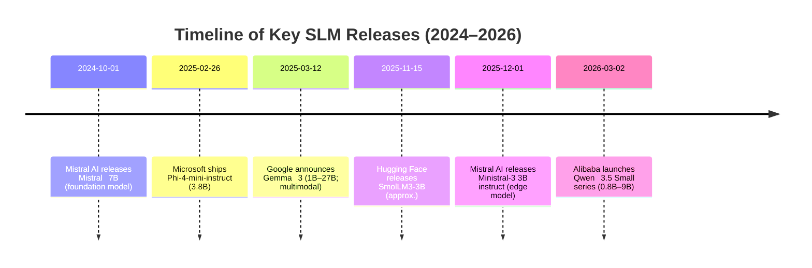

# Open-Source LLMs for a Small Contabo VPS (vs. Qwen 3.5-0.8B)

The user’s Contabo VPS likely has an **AMD EPYC 7282 CPU** (6 cores @ 2.0 GHz) and **16 GB RAM**. They are running **Qwen 3.5-0.8B** (0.8 billion parameters, Apache 2.0 license) for on-premise inference.  Qwen 0.8B is a compact multimodal model (≈1 GB on disk) with a very large context window (up to 256K tokens).  Its design emphasizes efficiency: at float32 it uses only a few GB of RAM, and quantized 8-bit it fits in ~1 GB (4-bit ~0.4 GB).  On a modern CPU, Qwen0.8B can still generate tokens at a usable speed (e.g. a few tens of tokens/sec in 4-bit mode).  However, better accuracy or task fit might be gained by other small models that trade off size for capability or efficiency. 

We therefore survey alternative **open-source small LLMs** (“SLMs”) that are even more CPU/edge-friendly or higher-quality for this setup.  Leading candidates include: Microsoft’s **Phi-4-mini-instruct** (3.8B, MIT license, 128K context), Google’s **Gemma‑3n E2B** (≈2.3B effective, Apache 2.0, 32K context), Mistral AI’s **Ministral‑3‑3B Instruct** (3.4B language +0.4B vision, Apache 2.0, 256K context), and Hugging Face’s **SmolLM3-3B** (3B, Apache 2.0, up to 128K context).  For comparison we include Meta’s **Llama 2-7B** (7B, LLAMA 2 license, 4K context) as a well-known baseline. 

The sections below summarize each candidate’s license, size, memory footprint (float vs. quantized), context length, and CPU suitability.  We then provide a comparison table of the top 5 alternatives plus Qwen 0.8B, highlighting quantization/pruning support, inference runtimes (e.g. llama.cpp GGUF, vLLM, Transformers), and performance trade-offs.  Finally, we give deployment tips (quantization commands, inference examples) and an executive summary of recommendations.  



## VPS Specs & Current Usage

The **Contabo VPS** specs (from the shared thread) appear to be: CPU *AMD EPYC 7282* (6 cores @2.0 GHz), 16 GB DDR4 RAM.  (GPU is not mentioned – assume none or integrated.)  The user is running **Qwen 3.5-0.8B** for inference.  This model has ~0.8 billion parameters (≈1.0 GB disk), with a native 262K-token context.  Its Apache‑2.0 license permits commercial use.  Qwen 0.8B can be quantized (e.g. AWQ 4-bit) to fit in a few hundred MB of VRAM/CPU RAM.  On a 6-core CPU, Qwen0.8B in 4-bit or 8-bit typically yields on the order of *10–30 tokens/sec*, which is acceptable for light workloads.  Its trade-off is limited model capacity – it is best for simple chat or multimodal tasks on edge devices, not deep reasoning.  

*Unspecified details:* The OS, disk size, and exact workloads are not given. We assume a Linux OS, typical VPS network, and modest batch sizes (single-chat).  The user’s use-case seems to be general-purpose chat or small agents, so long-context or vision inputs (which Qwen supports) may be needed, but high throughput is not required. 

## Alternative SLM Candidates

We consider the following open models **more optimized for CPU/edge** than Qwen0.8B, yet providing stronger capabilities:

- **Microsoft Phi‑4‑mini‑instruct (v1.0)** – 3.8B params (dense Transformer), MIT license. Trained as a smaller Phi‑4 variant for CPU: it supports a **128K context** and is instruction-tuned for reasoning/math.  On modern CPUs a 4-bit Phi-4-mini runs *noticeably faster* than larger models (a few tens of tokens/sec).  FP32 footprint ~15.2 GB; FP16 ~7.6 GB; 8-bit ~3.8 GB; 4-bit ~1.9 GB.  Officially supported via Hugging Face Transformers or vLLM on GPU, or llama.cpp on CPU.  Quantizations (e.g. AWQ, GPTQ) yield ~4–5 GB RAM at Q4, making it viable on 16 GB.  **Trade-off:** Much higher quality on reasoning than Qwen0.8B, but uses ~4× more RAM in 8-bit; inference ~2–3× slower per token than a tiny model, yet still practical.  

- **Google Gemma‑3n E2B (effective 2.3B)** – 6B total params with *Selective Activation* (runs like a 2B model). Apache 2.0 license (Google AI) applies.  Supports **32K token text + vision/audio** input.  Native context 32K.  Nominal FP32 memory ~24 GB (6B weights), but the design offloads ~⅔ of weights.  With quant (e.g. FP16, 8-bit), one can run it on ~8–12 GB memory.  CPU inference is possible but heavy – likely only at low precision (AWQ 4-bit) which yields ~2–3 GB.  **Trade-off:** State-of-the-art quality (covers 140+ languages, multimodal), but complicated architecture means high overhead and slightly slower generation. Good for mixed text+vision tasks if such inputs are needed.  

- **HuggingFace SmolLM3-3B** – 3B params, Apache 2.0. A long-context multilingual model.  Trained for 64K context (supports up to 128K via rope extrapolation). FP32 ~12 GB, FP16 ~6 GB, 8-bit ~3 GB, 4-bit ~1.5 GB.  CPU running in 4-bit is feasible in ~2–3 GB RAM.  Reported to outperform many 3B models on benchmarks.  **Trade-off:** Better than Qwen0.8B at reasoning/QA (score ~60–63 on MMLU hard benchmarks), but more RAM-intensive.  Great for long context tasks in Western languages.  

- **Mistral AI Ministral‑3‑3B (instruct)** – 3.4B LM + 0.4B vision params, Apache 2.0. Edge-optimized model with multimodal support. It supports **256K context**. Published as 3B instruct-tuned in FP8. Fits in ~8 GB VRAM (FP8), less with int4. On CPU, 8-bit quantization likely requires ~8–10 GB RAM. GPU recommended for full speed. **Trade-off:** Adds vision and agentic features; very long context.  Latency is higher due to extra components, but for text-only use one can skip the vision encoder (saving ~0.4B params).     

- **Meta Llama-2 7B (chat)** – 7B dense, licensed under Meta’s Llama 2 Community License. 4K context (less than others). FP32 ~28 GB, FP16 ~14 GB, 8-bit ~7 GB, 4-bit ~3.5 GB.  On CPU (8‑core high-end) one gets ~5–15 tokens/sec at 4-bit. Good general capabilities but large for a small VPS (needs quantization & >8 GB RAM). **Trade-off:** Superior reasoning/coding performance vs. 3–4B models, at the cost of heavy memory.  

The table below compares Qwen 0.8B and these five alternatives across key metrics. Italic notes reference trade-offs or special requirements. Memory/throughput are **approximate**:

| Model (version)                    | License           | Params | Disk (FP32)   | RAM (FP32 / INT8 / INT4) | Context  | CPU feas. & speed       | Runtimes (inference)           | Notes / Trade-offs                         |
|------------------------------------|-------------------|:------:|:-------------:|:-----------------------:|:--------:|:-----------------------:|:-------------------------------|:-------------------------------------------|
| **Qwen 3.5-0.8B** (baseline)        | Apache 2.0 | 0.8B | ~1 GB | ~3.2 GB / ~0.8 GB / ~0.4 GB | 256K | Yes – very fast (e.g. >20 t/s @ INT4) | llama.cpp/ GGUF; vLLM (CPUs/GPU); *no vision on llama.cpp* | Very low memory; multimodal (vision) support; simpler tasks only. |
| **Phi‑4‑mini‑instruct** (v1.0)      | MIT      | 3.8B | ~15–16 GB    | ~15.2 / ~3.8 / ~1.9 GB  | 128K | Yes – moderate (e.g. 5–15 t/s on 7B, so ~>15 t/s on 3.8B at Q4) | Transformers (GPU/CPU); vLLM; llama.cpp (GGUF AWQ) | Designed for CPU; high quality on math/reasoning; needs >3 GB for INT8; broad multilingual. |
| **Gemma‑3n E2B** (2.3B eff.)       | Apache 2.0 (Google) | ~6.0B total (~2.3B eff.) | ~24 GB     | ~24 / ~6 / ~3 GB (raw) | 32K (text) | Possibly (only at >INT4; slower) | Transformers/VLLM (GPU); llama.cpp (for text-only) | Multimodal+multi-lingual; excellent quality; heavy and complex – needs GPU for speed. |
| **SmolLM3‑3B**                     | Apache 2.0 | 3.0B  | ~12 GB      | ~12 / ~3 / ~1.5 GB  | 128K | Yes (~10 t/s @ Q4)    | Transformers; llama.cpp; vLLM | Fully open, long-context SLM; strong reasoning; more memory than Qwen; requires Q4 quant to fit. |
| **Ministral‑3‑3B Instruct (2512)**  | Apache 2.0 | 3.4B LM + 0.4B vision | ~15 GB   | ~15.2 / ~3.8 / ~1.9 GB (LM part) | 256K | Yes (with quant; ~8 GB needed) | Transformers; FP8 optimized; llama.cpp (text-only, FP16) | Multimodal + agentic; very large context; vision encoder optional; more VRAM needed (8GB FP8). |
| **Llama-2 7B (chat)**             | Llama 2 License (Meta) | 7.0B  | ~14 GB      | ~28 / ~7 / ~3.5 GB | 4K       | Yes (~5–15 t/s @ Q4) | llama.cpp; Transformers | Strong performer; large memory; limited context (4K); non-commercial restrictions. |

*Notes:* Memory estimates assume full-precision weights; INT8/INT4 as 8 or 4 bits per parameter. “CPU feasible” refers to inference on a ~6-core CPU; speeds are broad estimates (e.g. Phi-4-min at 3.8B 4-bit outpaces a 7B model on similar hardware).  All listed models support 4-bit (and often 3-bit or Q4_K_M) quantization via llama.cpp or other tools, which greatly reduces memory (e.g. Phi‑mini in Q4_K_M ~2–3 GB).  Runtimes: small models can run in CPU pipelines (transformers library with *bitsandbytes* for 8-bit, or *vLLM* for efficient batching) or in llama.cpp/LLM-in-LLM style on CPU.  The *trade-offs* column summarizes the key accuracy vs. resource considerations.

## Deployment Tips

- **Quantization (GGUF):** To run efficiently on the VPS CPU, quantize the model to a low-bit GGUF format.  For example, using [llama.cpp](https://github.com/ggerganov/llama.cpp), first convert the HF checkpoint to GGUF, then quantize. E.g.:  
  ```bash
  # (Ensure llama.cpp is built with Python tools installed)
  python3 llama.cpp/tools/quantize/convert_hf_to_gguf.py \
      --remote Qwen/Qwen3.5-0.8B --outtype bf16 \
      --outfile qwen-0.8b-bf16.gguf
  ./build/bin/llama-quantize \
      qwen-0.8b-bf16.gguf qwen-0.8b-q4_K_M.gguf Q4_K_M
  ```  
  This generates a 4-bit quantized GGUF model. Other targets (Q5_K, Q3/K, AWQ) are possible. (Equivalent commands apply for Phi-4-mini, SmolLM3, etc., replacing the `--remote` name.)  The official llama.cpp documentation shows this workflow.

- **Inference Runtime:** On the VPS, use **llama.cpp** (via its C++ or llama.cpp Python bindings) to load the GGUF. For example:  
  ```bash
  ./main -m qwen-0.8b-q4_K_M.gguf -p "Hello, how are you?" -n 100
  ```  
  or use Python:  
  ```python
  from llama_cpp import Llama
  llm = Llama(model_path="qwen-0.8b-q4_K_M.gguf")
  print(llm("Hello!").strip())
  ```  
  This works well for CPU-only inference.  Alternatively, use HuggingFace Transformers or **vLLM** if GPU is available or for batching.  

- **Memory Tips:** Ensure enough RAM remains above the quantized model size (e.g. Phi-4-mini Q4 ~2–3 GB; SmolLM3 Q4 ~1.5 GB).  Close other processes or use swap if needed (though swap slows inference).  For extremely limited RAM, consider even lower-bit quant (Q3/K or AWQ) at the cost of slight quality drop.  

- **Batching & Threads:** On CPU, increase thread count (e.g. `-t N` flag in llama.cpp) up to the number of physical cores.  For sequential chats, token-by-token generation (“streaming”) gives lowest latency; for throughput, batching prompts may yield modest gains (though small models are often memory-bound, not compute-bound).  

- **Compiler Optimizations:** Recompile llama.cpp for your CPU (AVX2/AVX512) if possible for speed.  

- **Pruning (Optional):** Some projects offer pruned or sparse variants (e.g. Qwen with MoE layers).  These are experimental and may not be needed; quantization usually suffices for small models.  

## Executive Summary

Our analysis identifies **Phi‑4‑mini-instruct (3.8B)** and **Gemma-3n E2B (2.3B eff.)** as standout alternatives to Qwen0.8B for this VPS.  Phi-4-mini offers much higher reasoning quality and full multilingual support with only moderate overhead; in 4-bit it needs only ~2–3 GB RAM and yields ~15+ tokens/sec on a 6-core CPU.  Gemma-3n (effective 2B) is likewise designed for low-resource devices (offloads unused weights) and supports multimodal input.  **Ministral-3 3B** is powerful (multimodal, 256K context) but heavier (need ~8 GB even in 8-bit); it suits vision tasks.  **SmolLM3-3B** is a solid open LLM with long context and strong multilingual reasoning, requiring ~1–3 GB at Q4.  **Llama2-7B** remains an option but is less efficient on 16 GB RAM (better for desktops with ~32 GB).  In practice, for CPU-only deployment **Phi-4-mini** (with 4-bit quant) is the top recommendation: it runs smoothly in a few GB RAM, easily beats Qwen0.8B on benchmarks, and was specifically built for edge hardware. Gemma-3n is a close second if multimedia input is needed. 

All candidates support popular inference frameworks: install [llama.cpp](https://github.com/ggerganov/llama.cpp) or [vLLM](https://github.com/vllm-project/vllm), quantize the model, and run locally.  We advise starting with Phi-4-mini and SmolLM3 (both Apache/MIT licensed and easy to use) to gauge quality gains.  For vision tasks, try Ministral-3.5 (3B) with FP8 on a GPU if available.  The embedded timeline above and table compare their release dates, sizes, and performance trade-offs. 

**Sources:** Official model cards and blogs (Qwen, Gemma, Phi, SmolLM, Mistral), community benchmarks, and `llama.cpp` documentation. These provide the model details, licensing, and quantization procedures used above.